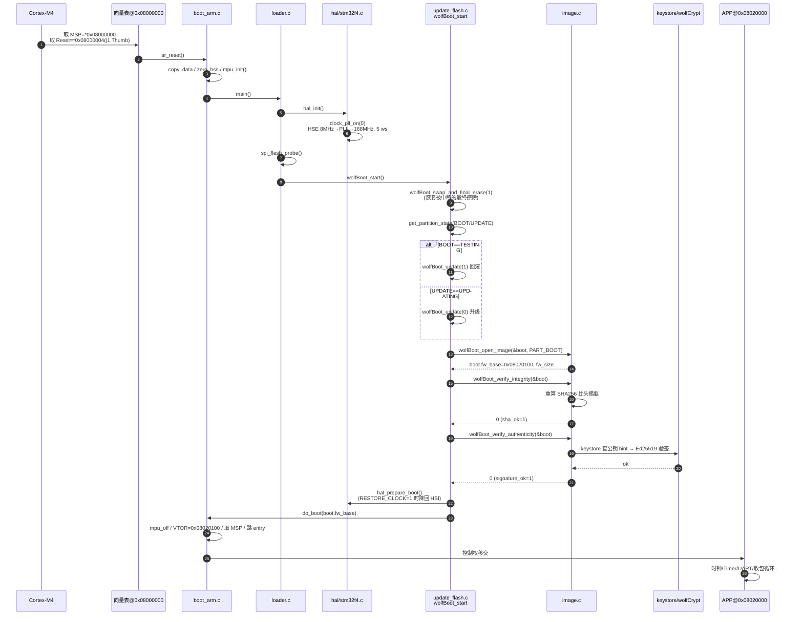
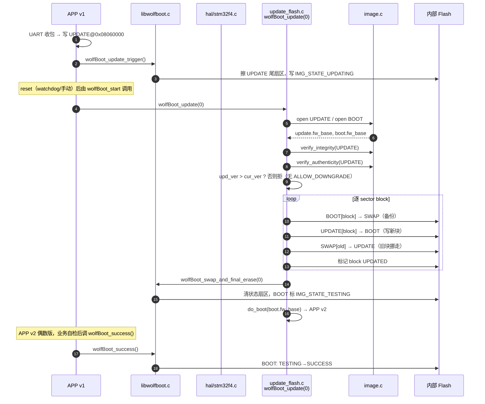
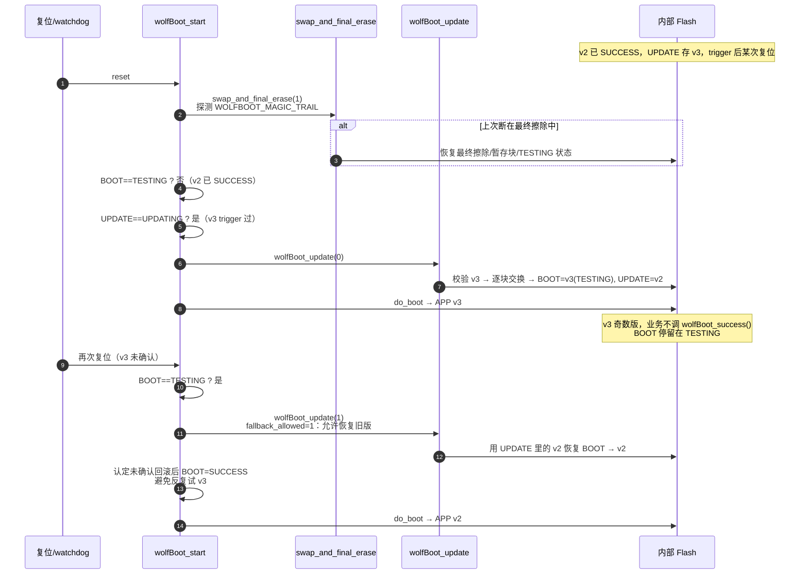

# wolfBoot 核心源码与知识点笔记（STM32F407 配置）

  

> 目标配置：`ARCH=ARM`、`TARGET=stm32f4`、`SIGN=ED25519`、`HASH=SHA256`、`IMAGE_HEADER_SIZE=256`、`WOLFBOOT_SECTOR_SIZE=0x20000`、`VTOR=1`、`DEBUG=1`。

> 分区布局（`config/flash-map.csv`）：BOOT `0x08020000`（0x40000）、UPDATE `0x08060000`（0x40000）、SWAP `0x080A0000`（0x20000）；wolfBoot 自身 `0x08000000` 起。

> 芯片：STM32F407ZGT6，Cortex-M4（ARMv7-M），1MiB 单 Bank Flash，外部 HSE 8MHz，PLL 168MHz。

> 所有路径均为 `vendor/wolfBoot` 下的相对路径，行号对应本快照源码。

  

---

  

## 第 1 章　总体流程认知

  

### 1.1 源码路径地图（按本配置实际参与编译的文件）

  

```

vendor/wolfBoot/

├── src/

│   ├── boot_arm.c        ← 启动向量 + isr_reset + do_boot（ARMv7-M 分支）

│   ├── loader.c          ← main()：hal_init → spi_flash_probe → wolfBoot_start

│   ├── libwolfboot.c     ← 分区状态/TLV/版本/trigger/success/Flash 访问封装

│   ├── image.c           ← wolfBoot_open_image / verify_integrity / verify_authenticity

│   ├── update_flash.c    ← wolfBoot_start 状态机 + wolfBoot_update + swap_and_final_erase

│   ├── keystore.c        ← keygen 生成的授权公钥表（本配置 ED25519 一把）

│   ├── string.c          ← 裸机 memcpy/memset/memcmp（Flash/RAM 搬运会调用）

│   └── delta.c           ← delta update（本配置默认 CFLAGS 加 -DDELTA_UPDATES，预留）

├── hal/

│   ├── stm32f4.c         ← hal_init / hal_prepare_boot / clock_pll_on/off / flash_* / wait states

│   └── uart/uart_drv_stm32f4.c ←（APP 端用，wolfBoot 自身 DEBUG_UART=0 默认不编进来）

├── include/

│   ├── image.h           ← struct wolfBoot_image、sanity/verification 宏、TLV 常量

│   ├── loader.h          ← IMAGE_SIGNATURE_SIZE（Ed25519=64）、wolfBoot_start 声明

│   ├── hal.h             ← HAL 接口（hal_init/hal_flash_*/hal_prepare_boot 等）

│   ├── hooks.h           ← wolfBoot_hook_preinit/postinit（本配置未启用）

│   └── wolfboot/wolfboot.h ← APP 公共 API：wolfBoot_success/update_trigger/current_firmware_version

└── test-app/

    ├── app_stm32f4.c     ← 测试 APP main：时钟/Timer/UART/收包循环 → wolfBoot_update_trigger

    ├── startup_arm.c     ← APP 侧启动（isr_reset，链接在 0x08020000）

    ├── timer.c / led.c   ← APP 外设演示

    └── libwolfboot.o     ← APP 也链一份 libwolfboot（调 wolfBoot_* API 用）

```

  

> 被条件编译**排除**（本配置未启用，读代码时先折叠）：`tpm.c`、`uart_flash.c`、`encrypt.c`、`pkcs11_*.c`、`wolfhsm_*.c`、`stage1/`、`x86/`、`aarch64`/`riscv`/`ppc` 等其它架构的 `boot_*.c`、`disk*.c`、`elf.c`、`fdt.c`、`gpt.c`、`multiboot.c`。

  

### 1.2 关键功能节点与函数接口速查

  

| 阶段 | 函数 | 文件:行 | 作用 |

|------|------|---------|------|

| 复位入口 | `isr_reset` → `isr_reset_c` | `src/boot_arm.c:263` | 复制 `.data`、清 `.bss`、`mpu_init()`、调 `main()` |

| C 入口 | `main` | `src/loader.c:110` | `hal_init()`→`spi_flash_probe()`→`wolfBoot_start()`（TPM/UART_FLASH/FIPS 本配置不走） |

| HAL 初始化 | `hal_init` | `hal/stm32f4.c:362` | `clock_pll_on(0)`→168MHz、5 wait states、可选 `spi_init` |

| 状态机入口 | `wolfBoot_start` | `src/update_flash.c:1697` | 读 BOOT/UPDATE 状态、恢复中断的 final erase、走更新或直接认证 BOOT |

| 状态读 | `wolfBoot_get_partition_state` | `src/libwolfboot.c:796` | 从分区尾部 trailer 读状态字节 |

| 状态写 | `wolfBoot_set_partition_state` | `src/libwolfboot.c:739` | 擦状态扇区尾部再写（写前擦整 Sector） |

| 恢复收尾 | `wolfBoot_swap_and_final_erase(1)` | `src/update_flash.c:488` | 探测 `WOLFBOOT_MAGIC_TRAIL`，恢复被中断的最终擦除 |

| 升级主流程 | `wolfBoot_update(fallback_allowed)` | `src/update_flash.c:1046` | 开 UPDATE/BOOT → 校验类型/容量/Hash/签名/版本 → 逐块交换 |

| 镜像视图 | `wolfBoot_open_image` | `src/image.c:1770` | 解析 256B 头、TLV、算 `fw_base`/`fw_size` |

| 完整性 | `wolfBoot_verify_integrity` | `src/image.c:1961` | 按 HEADER_HASH TLV 重算 SHA256 比对 |

| 真实性 | `wolfBoot_verify_authenticity` | `src/image.c:2647` | 公钥 hint 查 keystore → Ed25519 验签 |

| 跳转 APP | `do_boot(app_offset)` | `src/boot_arm.c:532` | Armv7-M：关 MPU→设 VTOR→取 MSP→跳 entry（带 Thumb 位） |

| APP 触发 | `wolfBoot_update_trigger` | `src/libwolfboot.c:893` | 擦 UPDATE 尾扇区写 `IMG_STATE_UPDATING` |

| APP 确认 | `wolfBoot_success` | `src/libwolfboot.c:964` | 把 BOOT 状态从 `TESTING` 改 `SUCCESS` |

| HAL 收尾 | `hal_prepare_boot` | `hal/stm32f4.c:371` | `WOLFBOOT_RESTORE_CLOCK=1` 时 `clock_pll_off()` 降回 HSI |

  

### 1.3 压缩版全流程伪代码（本配置实际必经路径）

  

```

;; ============ ARMv7-M 复位（wolfBoot 向量表 @ 0x08000000）============

isr_reset():                      ; boot_arm.c:263

    copy .data  flash(_stored_data) -> RAM(_start_data.._end_data)

    zero .bss   _start_bss.._end_bss

    mpu_init()

    main()                        ; tail-call

  

;; ============ wolfBoot C 入口 ============

main():                           ; loader.c:110（无 LOADER_MAIN/TPM/UART_FLASH/FIPS）

    hal_init():                  ;   clock_pll_on(0): HSE→PLL→SYSCLK=168MHz, 5 wait states

    spi_flash_probe()

    wolfBoot_start():            ;   ── 不返回，失败则 wolfBoot_panic ──

      bootState   = get_partition_state(PART_BOOT)    ; 可能 -1（空 trailer）

      updateState = get_partition_state(PART_UPDATE)

      resumedFinalErase = wolfBoot_swap_and_final_erase(1)  ; 恢复中断的最终擦除

      if bootState == TESTING:

          wolfBoot_update(1)                            ; 回滚：用 UPDATE 里的旧版恢复

      elif updateState == UPDATING:

          wolfBoot_update(0)                            ; 正常升级：验证 UPDATE 后交换

      ;; —— 认证 BOOT ——

      bootRet = wolfBoot_open_image(&boot, PART_BOOT)

      if bootRet >= 0:

          bootRet = wolfBoot_verify_integrity(&boot)     ; 重算 SHA256 比头里的摘要

      if bootRet >= 0:

          bootRet = wolfBoot_verify_authenticity(&boot)  ; keystore 找公钥 → Ed25519 验签

      if bootRet < 0:                                    ; BOOT 非法

          if wolfBoot_update(1) < 0:  wolfBoot_panic()   ; 紧急恢复失败 → 死

          wolfBoot_open_image(&boot, PART_BOOT)          ; 恢复成功再 open+verify 一次

          (verify_integrity(&boot) || verify_authenticity(&boot)) || wolfBoot_panic()

      hal_prepare_boot()                                 ; 可选降回 HSI

      do_boot(boot.fw_base)                              ; 跳 APP @ 0x08020100

  

;; ============ wolfBoot_update（升级/回滚，被上面三处调用）============

wolfBoot_update(fallback_allowed):               ; update_flash.c:1046

    open UPDATE; open BOOT

    if open UPDATE 失败: fw_size = wolfBoot_swap_update_size()   ; 从 SWAP 恢复头

    verify 类型/容量/Hash/签名

    if !fallback_allowed && upd_ver <= cur_ver: return -1       ; 拒同版/降级

    for each sector in [0 .. fw_size):           ; 逐块交换（备份模式）

        BOOT[block] → SWAP                        ; wolfBoot_copy_sector

        UPDATE[block] → BOOT                     ; 写新块到 BOOT

        SWAP[old] → UPDATE                       ; 旧块挪到 UPDATE

        mark block UPDATED

    wolfBoot_swap_and_final_erase(0)            ; 收尾：清状态扇区、写 TESTING

    return 0

  

;; ============ 跳进 APP 后（独立程序，链接在 0x08020000）============

app main():                                      ; test-app/app_stm32f4.c

    时钟/Timer/UART(115200) 初始化

    while time_elapsed==0: WFI()

    version = wolfBoot_current_firmware_version()

    if (version & 1)==0:  wolfBoot_success()     ; 偶数版（v1/v2）调确认

    UART 收包循环：

        收到整包 → 写 UPDATE 分区 → 收齐后

        wolfBoot_update_trigger()               ; 标记 UPDATING

    while(1);                                     ; 等 watchdog/reset 重启进 wolfBoot_update(0)

```

  

### 1.4 UML 序列图

  

#### 图 1-1　冷启动：从复位到跳进 APP（正常路径）

  



  

#### 图 1-2　APP 触发的正常升级（v1→v2）

  



  

#### 图 1-3　断电恢复与不确认回滚（v2→v3 不确认）

  



  

### 1.5 组件构成认知（一句话职责）

  

- **`boot_arm.c`**：CRT runtime（`.data`/`.bss`/MPU）+ `do_boot` 跳转；CPU 复位的最低层。

- **`loader.c`**：`main`，按本配置只做 `hal_init`+`spi_flash_probe`+`wolfBoot_start`；条件分支多但 STM32F407 走最简路径。

- **`update_flash.c`**：启动状态机 `wolfBoot_start` + 更新/回滚 `wolfBoot_update` + 断电恢复 `swap_and_final_erase`。**wolfBoot 的核心大脑**。

- **`image.c`**：把 Flash 上的字节变成"可接受的镜像视图"——open/integrity/authenticity。安全策略的执行点。

- **`libwolfboot.c`**：分区 trailer、TLV、版本、`trigger`/`success`、Flash 访问的封装层，APP 和 Bootloader 共用。

- **`hal/stm32f4.c`**：RCC/FLASH/SPI 寄存器细节，把抽象的 `hal_flash_erase(addr,len)` 翻译成 STM32 Sector 操作。

- **`keystore.c` + wolfCrypt（`lib/wolfssl/`）**：信任根（公钥表）+ 算法（`ed25519.c`/`sha256.c`）。Bootloader 只持有公钥，不存私钥。

- **`test-app/app_stm32f4.c`**：业务侧 demo，演示"收包→写 UPDATE→trigger→等复位"和"偶数版调 success"。

  

> 三个角色分工：**算法库**保证数学正确；**Bootloader** 保证"何时验、验什么、验失败是否仍跳转、断电能否恢复"；**发布系统**保证"谁能签"。三者缺一都可能出问题。

  

---

  

## 第 2 章　详细代码阅读指导

  

> 推荐阅读顺序按"复位入口 → 状态机 → 镜像校验 → 跳转 → 升级/回滚 → APP 侧"层层深入。每节给出**文件:行**、**读代码要回答的问题**、**本配置注意点**。

> 调试时配合 `notes/note_debug.md` 的断点表，断在对应函数后用 `info args`/`p var` 验证本节描述。

  

### 2.1 `src/boot_arm.c` — 复位与跳转（先读这层，建立"裸机入口"直觉）

  

**关键函数与行号：**

- `isr_reset` / `isr_reset_c`（行 263）：向量表第 0/1 项之外的 C 复位入口。

- `do_boot(const uint32_t *app_offset)`（行 532）：跳 APP。

- `mpu_init` / `mpu_off`（行 132 / 183）：MPU 区域配置。

  

**读代码要回答：**

1. `.data` 从哪里复制到哪里？链接脚本里 `_stored_data`/`_start_data`/`_end_data` 的值是多少？（看 `test-app/ARM-stm32f4.ld` 或 `include/wolfboot/polyfill.ld`，wolfBoot 自身用 `ARM.ld`）

2. `.bss` 清零范围由谁决定？为什么不能少？

3. `do_boot` 对 STM32F407（`__ARM_FEATURE_CMSE` 未定义、非 Cortex-R5/M23/M33/M55）走哪一支？→ **Armv6/v7 分支（行 614-635）**：`mpu_off()` → `VTOR = app_offset` → `app_end_stack = *app_offset`（栈顶）→ `app_entry = *(app_offset+1)`（Reset 向量，带 Thumb 位）→ `msr msp` → `mov pc, app_entry`。

4. 为什么要先 `VTOR=` 再取 MSP？因为 APP 的向量表就在 `app_offset` 处，栈顶是第 0 个字、Reset 是第 1 个字（带 Thumb 位 `|1`）。

  

**本配置注意点：**

- STM32F407 是 Cortex-M4（ARMv7-M），**不**走 `CORTEX_M33/M55/M23` 的 `blxns` 分支，也不走 `CORTEX_R5`。

- `WOLFBOOT_NO_MPU` 未定义 → `mpu_init/off` 实际编译进来（静态实现，6 个硬件断点之外 MPU 不占断点）。

- `VTOR=1`（配置里开了）→ `NO_VTOR` 未定义 → `do_boot` 会写 `SCB->VTOR`（`0xE000ED08`）。

  

### 2.2 `src/loader.c` — C 入口 `main`（搞清"本配置实际走哪些分支"）

  

**关键函数与行号：**

- `main(void)`（行 110，本配置走这一支，不是 `loader_main` 也不是 `TARGET_sim` 的 `main(int argc,...)`）。

  

**读代码要回答：**

1. 哪些 `#ifdef` 在本配置下为真？→ `HAVE_FIPS` 否、`TARGET_sim` 否、`WOLFBOOT_LOADER_MAIN` 否、`RAM_CODE` 否、`UART_FLASH` 否（`DEBUG_UART=0` 不等于开 UART_FLASH）、`WOLFBOOT_TPM` 否、`WOLFCRYPT_SECURE_MODE` 否、`WOLFBOOT_HOOK_LOADER_*` 否。

2. 所以本配置 `main` 实际执行的就是：`hal_init()` → `spi_flash_probe()` → `wolfBoot_start()` → `wolfBoot_panic()`。中间一大堆 `#ifdef` 块全部折叠掉。

3. 为什么末尾还有 `wolfBoot_panic()`？因为 `wolfBoot_start` 声明为不返回；正常路径里它最终 `do_boot` 跳走，万一认证全失败又恢复不出来，会走到 panic。

  

**本配置注意点：**

- 不要把 `loader_main` 当入口——那是 `WOLFBOOT_LOADER_MAIN` 的分支，本配置没定义。查 `build/boot-symbols.txt` 确认只有 `main`。

- `spi_flash_probe()` 在 STM32F407（无外部 SPI Flash）基本是空操作，但会走一遍；不影响后续。

  

### 2.3 `src/update_flash.c` — `wolfBoot_start` 状态机（核心，重点读）

  

**关键函数与行号：**

- `wolfBoot_start`（行 1697，`RAMFUNCTION`）：每次复位的总调度。

- `wolfBoot_update(fallback_allowed)`（行 1046，`RAMFUNCTION`，`static`）：升级/回滚。

- `wolfBoot_swap_and_final_erase(resume)`（行 488，`RAMFUNCTION`，`static`）：断电恢复收尾。

- `wolfBoot_copy_sector` / `wolfBoot_backup_last_boot_sector`（`docs/source-functions.md` 给出行 278 / 394）：逐块搬运。

  

**`wolfBoot_start` 读代码要回答：**

1. 三个状态机入口条件分别什么含义？

   - `bootState == IMG_STATE_TESTING`：上次启动的 BOOT 还没被 APP 确认 → 走 `wolfBoot_update(1)` 回滚（把 UPDATE 里的旧版恢复回 BOOT）。

   - `updateState == IMG_STATE_UPDATING`：APP 已经 `wolfBoot_update_trigger()` 过 → 走 `wolfBoot_update(0)` 正常升级。

   - 两者都不是 → 直接认证当前 BOOT。

2. 为什么先调 `wolfBoot_swap_and_final_erase(1)` 再判状态？→ 防止"上次断在最终擦除阶段"，必须先把状态恢复到一致才能正确判断。

3. 认证 BOOT 失败（`bootRet < 0`）后的兜底路径：`wolfBoot_update(1)` 紧急恢复；恢复成功后**再 open+verify 一次** BOOT（行 1822-1825），因为 BOOT 内容已被 update 改写。第二次再失败才 `wolfBoot_panic()`。

4. `IMG_STATE_*` 常量值在 `include/wolfboot/wolfboot.h`：`NEW`、`UPDATING`、`TESTING`、`SUCCESS`、`FINAL_FLAGS` 等。

  

**本配置注意点：**

- `WOLFBOOT_SELF_UPDATE_MONOLITHIC` 未定义 → 走备份模式（双分区 + SWAP），`DISABLE_BACKUP` 未定义。

- `RAMFUNCTION` 宏把这些函数放到 RAM 段（`__attribute__((section(".ramfunc")))`）——因为擦写同 Bank Flash 时不能从 Flash 取指。STM32F407 单 Bank，擦写时这些代码必须在 RAM 里跑。链接脚本里 `.ramfunc` 段的 LMA 在 Flash、VMA 在 RAM，`isr_reset` 复制 `.data` 时顺带把它们拷到 RAM。

- `wolfBoot_update(0)` 内部会拒同版/降级（无 `ALLOW_DOWNGRADE`），所以 v1→v1 或 v2→v1 正常路径会被拒；`wolfBoot_update(1)` 才允许 fallback。

  

### 2.4 `src/image.c` — 镜像校验三道门（open / integrity / authenticity）

  

**关键函数与行号：**

- `wolfBoot_open_image`（行 1770）→ `wolfBoot_open_image_address`（行 1585）：解析头、建视图。

- `wolfBoot_verify_integrity`（行 1961）：重算 SHA256 比头里的 `HEADER_HASH`。

- `wolfBoot_verify_authenticity`（行 2647）：查 keystore + Ed25519 验签。

- `keyslot_CT_hint_matches`（行 2971）/ `keyslot_id_by_sha`（行 2993）：公钥 hint 匹配。

  

**读代码要回答：**

1. `struct wolfBoot_image`（`include/image.h`）里有哪些字段？→ `hdr`（头基址）、`fw_base`（去掉 256B 头后的代码基址）、`fw_size`、`part`、`hdr_ok`/`sha_ok`/`signature_ok` 三个标志位。这是**运行期视图**，不是磁盘格式。

2. `wolfBoot_open_image` 做了哪些 sanity 检查？→ magic、头大小、`fw_base = image + IMAGE_HEADER_SIZE`、`fw_size` 从 TLV 取、范围不越过分区。

3. `wolfBoot_verify_integrity` 为什么不是简单地 `sha256(fw)`？→ 它按 HEADER 里记录的 hash 类型 TLV 重新算，再和 TLV 里的摘要比；本配置是 SHA256。

4. `wolfBoot_verify_authenticity` 怎么找公钥？→ 头里有公钥 hint（公钥本身的 hash），用 `keyslot_CT_hint_matches` 在 `keystore.c` 的公钥表里找匹配 slot；找到后检查该 slot 是否被授权用于当前分区（本配置只有一把 ED25519 key，授权给 BOOT 和 UPDATE）。然后调 wolfCrypt `wc_ed25519_verify_msg` 验签。

5. 验签失败会怎样？→ `signature_ok=0`，返回负值；调用方（`wolfBoot_start`）据此走兜底。

  

**本配置注意点：**

- Ed25519 验签内部用 SHA512，所以编译会链 `lib/wolfssl/wolfcrypt/src/sha512.c`——**这不是镜像摘要换成了 SHA512**，而是 Ed25519 算法本身依赖 SHA512。

- `SPMATH=1` 影响 sp_int 的内存分配策略，不影响验签结果。

- `IMAGE_HEADER_SIZE=256`：头 256B 里放 magic + 版本 + TLV（hash、签名、公钥 hint、img_type 等），代码从 `+256` 开始。所以 BOOT 代码基址 `fw_base = 0x08020000 + 0x100 = 0x08020100`，APP 向量表就在这。

  

### 2.5 `src/libwolfboot.c` — 分区状态、TLV、trigger/success（共享层）

  

**关键函数与行号：**

- `get_partition_state`（行 687，`RAMFUNCTION`，`static`）/ `set_partition_state`（行 693）：读写分区尾部 trailer 的状态字节。

- `wolfBoot_get_partition_state`（行 796）/ `wolfBoot_set_partition_state`（行 739）：对外的加锁包装。

- `wolfBoot_update_trigger`（行 893）：APP 调，标记 UPDATE 为 UPDATING。

- `wolfBoot_success`（行 964）：APP 调，把 BOOT 从 TESTING 改 SUCCESS。

- `wolfBoot_find_header`（行 1358）：TLV 遍历。

- `wolfBoot_get_blob_version`（行 1581）：从 TLV 取版本号。

  

**读代码要回答：**

1. 状态字节在 Flash 的哪个位置？→ 每个分区末尾 `WOLFBOOT_PARTITION_SIZE - 1` 处（trailer 区），`SECTOR_FLAGS_SIZE = WOLFBOOT_SECTOR_SIZE - (4+1)`：MAGIC(4B) + PART_FLAG(1B)。所以写一个状态字节前要先擦**整个状态 Sector**（128KiB），这就是 `set_partition_state` 会擦扇区的原因。

2. `wolfBoot_update_trigger` 具体改了什么？→ 擦 UPDATE 尾扇区，写 `IMG_STATE_UPDATING`。注意它**不**校验 UPDATE 内容，只标记"请求升级"；真正校验发生在下次复位 `wolfBoot_update(0)`。

3. `wolfBoot_success` 为什么要先读再写？→ 只在 BOOT 当前是 `TESTING` 时才改 `SUCCESS`；已经 SUCCESS 的不重复写（避免无谓擦写）。

4. `wolfBoot_find_header` 的 TLV 格式？→ 每个 TLV：`type(2B) | len(2B) | value`，遍历到 `HDR_END` 或长度溢出停止。常见 type：`HDR_VERSION`、`HDR_IMG_TYPE`、`HDR_SHA256`（摘要）、`HDR_SIGNATURE`、`HDR_PUBKEY`（hint）。

  

**本配置注意点：**

- APP（`test-app/`）和 Bootloader 都链 `libwolfboot.o`——所以 `wolfBoot_update_trigger`/`wolfBoot_success` 既能在 APP 里调（APP 调），也能在 Bootloader 里调（内部状态机用）。这是"共享层"的含义。

- `wolfBoot_current_firmware_version()`（行 1768 附近）就是 `wolfBoot_get_blob_version(wolfBoot_get_image_from_part(PART_BOOT))`，APP 用它判断自己是奇数版还是偶数版。

- `RAMFUNCTION` 同样适用于这些状态操作——擦写同 Bank Flash 时不能从 Flash 执行。

  

### 2.6 `hal/stm32f4.c` — HAL 寄存器细节（把抽象地址翻译成 STM32 Sector）

  

**关键函数与行号：**

- `hal_init`（行 362）：`clock_pll_on(0)` + 可选 `spi_init`。

- `clock_pll_on(powersave)`（行 283）：HSE 8MHz → PLL → 168MHz；5 wait states；APB1 ÷4、APB2 ÷2。

- `clock_pll_off`（行 264）：切回 HSI，给 APP 一个干净时钟域（`WOLFBOOT_RESTORE_CLOCK=1` 时用）。

- `flash_set_waitstates`（行 139）：写 `FLASH_ACR`。

- `hal_flash_unlock` / `hal_flash_lock` / `hal_flash_erase` / `hal_flash_write` / `flash_wait_complete`（`docs/source-functions.md` 给出行）：FLASH KEYR 解锁、SNB 选 Sector、STRT 启动、轮询 `BSY`。

- `hal_prepare_boot`（行 371）：`WOLFBOOT_RESTORE_CLOCK=1` 时 `clock_pll_off()`。

  

**读代码要回答：**

1. STM32F407 Flash 几何？→ 行 108-120：S0~3 各 16KB、S4 64KB、S5~11 各 128KB，共 1MiB。本配置 BOOT 在 `0x08020000`（S5 起），UPDATE `0x08060000`（S6 起），SWAP `0x080A0000`（S8 起），wolfBoot 自身 `0x08000000`~`0x0801FFFF`（S0~S4，含分区表/状态？不，wolfBoot 代码只占 S0~S4 的前面，`0x08020000` 才是 BOOT）。

2. `hal_flash_erase(addr, len)` 怎么把绝对地址映射到 Sector？→ 用 `flash_sector[]` 表二分/线性找覆盖 `addr..addr+len` 的 Sector，逐个 `SER|SNB|STRT`。注意**不能擦任意 4KB**，最小粒度是 Sector（16KB 起）。

3. `flash_wait_complete` 是忙等待还是中断？→ 轮询 `FLASH_SR_BSY`；`WOLFBOOT_RESTORE_CLOCK` 期间如果还在 168MHz，wait states 必须先设好。

4. `hal_flash_write` 的写粒度？→ 按 `FLASH_CR_PROGRAM_*`（x8/x16/x32/x64），STM32F407 是 32-bit 并行 Flash，写以字/双字为单位。

  

**本配置注意点：**

- 板级 overlay（探索者）只改 `flash_waitstates=5`（168MHz@2.7-3.6V），物理 Flash 几何沿用官方。

- `WOLFBOOT_RESTORE_CLOCK=1`（配置里开了）→ `hal_prepare_boot` 会 `clock_pll_off`，所以 APP 进来时是 HSI 8MHz，APP 自己再重新配 PLL。这避免了"APP 假设时钟已配好"的隐式依赖。

- 单 Bank：擦写 BOOT 时**不能同时从 BOOT 取指**——这就是 `wolfBoot_update` 系列要 `RAMFUNCTION` 的根本原因。

  

### 2.7 `test-app/app_stm32f4.c` — APP 侧（看业务如何配合 Bootloader）

  

**关键函数与行号：**

- `main`（约行 240 起，`TARGET_stm32f4` 分支）：时钟/Timer/UART 初始化 → `time_elapsed` 等 → 偶数版调 `wolfBoot_success()` → UART 收包循环 → 收齐调 `wolfBoot_update_trigger()`。

- `wolfBoot_current_firmware_version()`：读自己版本号。

  

**读代码要回答：**

1. APP 为什么 `if ((version & 0x01) == 0) wolfBoot_success()`？→ demo 约定：偶数版（v1/v2）= "健康"，调 `wolfBoot_success` 把 BOOT 从 TESTING 改 SUCCESS，下次复位就稳定运行它；奇数版（v3）= "故意不确认"，留给 watchdog 复位触发回滚演示。

2. UART 收包协议是什么？→ `0xA5 0x5A` 起帧，`len(4B) | seq(4B) | payload | ?`，每 256B 一页写 UPDATE（`dst = UPDATE_ADDR + offset`，按 Sector 边界 `hal_flash_erase`）。收齐 `next_seq >= tot_len` 后调 `wolfBoot_update_trigger()` 然后 `while(1)` 等复位。

3. APP 调 `wolfBoot_update_trigger` 之后做什么？→ **什么都不做，等复位**。Bootloader 在下次复位时才真正执行 `wolfBoot_update(0)`。这是"触发与执行分离"。

  

**本配置注意点：**

- 默认 `USE_UART3`，本配置 `.config` 加了 `CFLAGS_EXTRA=-DUSE_UART1`，所以 APP 走 UART1（PA9/PA10，探索者板上接的口）。`notes/note_debug.md` 故障表里的"串口无输出查 PA9/PA10"就来自这。

- APP 链接在 `0x08020000`（BOOT 分区起点），它的 `isr_reset`/向量表也在那。wolfBoot 的 `do_boot` 把 `VTOR=0x08020100`（跳过 256B 头）后跳 APP 的 Reset。

  

### 2.8 `wolfBoot_update` 逐块交换细节（断电安全的精髓）

  

读 `wolfBoot_update`（行 1046）和 `wolfBoot_swap_and_final_erase`（行 488）时重点理解这套"BOOT↔UPDATE 逐块对换 + SWAP 临时备份"为什么断电安全：

  

1. **逐块**（`WOLFBOOT_SECTOR_SIZE=128KB` 为单位）：每次只动一个 block，写完立刻标记该 block `UPDATED`（sector nibble）。断电后下次复位看 nibble 就知道哪些 block 已完成，跳过它们。

2. **三步对换**：`BOOT[i] → SWAP`（备份旧块）→ `UPDATE[i] → BOOT`（新块就位）→ `SWAP[old] → UPDATE`（旧块挪到 UPDATE，为下次回滚留底）。三步都用 `wolfBoot_copy_sector`。

3. **最终擦除**（`swap_and_final_erase`）：所有 block 换完后，还要清掉状态扇区的旧标记、把 BOOT 标 `TESTING`、把 UPDATE 留旧版。这步如果断电，`WOLFBOOT_MAGIC_TRAIL` 标记能让下次复位认出"中断在最终擦除"，重新进入恢复。

4. **第一块含头**：交换第一块后 BOOT/UPDATE 的 256B 头就互换了，所以源码在换第一块后会**重新 `wolfBoot_open_image`** 调整 `fw_size` 和剩余范围（行 133 附近 docs 提到）。不要拿函数入口时的两个结构体大小一直推到底。

  

**读代码要回答：**

1. `SECT_FLAG_NEW` / `SECT_FLAG_SWAPPING` / `SECT_FLAG_BACKUP` / `SECT_FLAG_UPDATED` 这些 nibble 状态在哪个函数被读/写？→ `get_update_sector_flags` / `set_update_sector_flags`（`libwolfboot.c`，行见 `docs/source-functions.md`）。

2. 为什么 `wolfBoot_update(1)`（fallback）能恢复旧版而 `wolfBoot_update(0)` 不能？→ `fallback_allowed=1` 时跳过"upd_ver > cur_ver"的版本检查（行 1095 之后的版本比较分支），允许用 UPDATE 里较旧的镜像恢复 BOOT。

3. `wolfBoot_swap_update_size`（行 967 附近）干嘛用？→ 当 `wolfBoot_open_image(UPDATE)` 失败（头被擦了，可能断在中途），从 SWAP 里恢复 `fw_size`。

  

### 2.9 `src/keystore.c` + `lib/wolfssl/wolfcrypt/` — 信任根与算法

  

**读代码要回答：**

1. `keystore.c` 是谁生成的？→ `build.sh` 调 `tools/keytools/keygen --ed25519 -g wolfboot_signing_private_key.der` 生成私钥，再生成 `src/keystore.c`（公钥表）。本配置一把 ED25519 key，授权 BOOT 和 UPDATE。

2. Bootloader 持有公钥还是私钥？→ **只有公钥**（`keystore.c` 里是公钥）。私钥 `wolfboot_signing_private_key.der` 留在主机侧 `tools/keytools/sign` 签名用，**不进设备**。

3. Ed25519 验签调用链？→ `wolfBoot_verify_authenticity` → `keyslot_id_by_sha` 找公钥 → `wc_ed25519_verify_msg`（`lib/wolfssl/wolfcrypt/src/ed25519.c`）→ 内部 `wc_Sha512`（`sha512.c`）。

4. 为什么镜像摘要用 SHA256 但验签链 SHA512？→ 镜像完整性（`verify_integrity`）用配置 `HASH=SHA256`；Ed25519 算法规范内部用 SHA512，两者独立。

  

---

  

## 第 3 章　关键知识点速查（面试/复习向）

  

| 知识点 | 一句话 | 深入位置 |

|--------|--------|----------|

| **双分区 + SWAP** | BOOT/UPDATE 两份镜像 + 一个 SWAP 备份区；升级时逐块对换，断电可恢复 | `update_flash.c` 状态机 + flash-map |

| **断电安全** | 靠 sector nibble 标记 + `WOLFBOOT_MAGIC_TRAIL` + 恢复入口 `swap_and_final_erase(1)` | `update_flash.c:488` |

| **三道门** | open（头/范围）→ integrity（SHA256）→ authenticity（Ed25519 验签） | `image.c:1770/1961/2647` |

| **信任根** | 设备只存公钥（keystore.c）；私钥在主机签名工具，不进设备 | `tools/keytools/keygen`+`sign` |

| **版本策略** | 正常 `wolfBoot_update(0)` 拒同版/降级；回滚 `wolfBoot_update(1)` 允许 fallback | `update_flash.c:1046` |

| **触发与执行分离** | APP 调 `wolfBoot_update_trigger` 只标记 UPDATING；真正交换在下次复位 Bootloader 里 | `libwolfboot.c:893` |

| **确认机制** | APP 业务自检后调 `wolfBoot_success` 把 BOOT 从 TESTING 改 SUCCESS；不确认则回滚 | `libwolfboot.c:964` |

| **RAMFUNCTION** | 擦写同 Bank Flash 时不能从 Flash 取指，关键函数放 RAM 段 | `.ramfunc` + `isr_reset` 复制 |

| **跳转不重定位** | `do_boot` 只设 `VTOR`+`MSP` 后跳 entry；APP 必须链接在固定地址（0x08020000） | `boot_arm.c:532` Armv7-M 分支 |

| **头格式** | 256B 头 = magic + 版本 + TLV（hash/签名/公钥hint/img_type）；代码从 +256 开始 | `include/image.h` |

| **签名不加密** | 签名保证真实性和完整性，不保密；Flash 里 APP 是明文 | 配置无 `EXT_ENCRYPTED` |

| **时钟移交** | `WOLFBOOT_RESTORE_CLOCK=1` → `hal_prepare_boot` 降回 HSI，APP 自己重配 PLL | `stm32f4.c:371` |

  

---

  

## 附：相关文档与本笔记的关系

  

- `notes/note_debug.md`：**怎么调试**（断点表、流程、源文件打不开修复）。

- 本笔记 `notes/note_source_code.md`：**源码在做什么、怎么读**（流程、函数地图、知识点）。

- `docs/01-build.md` ~ `docs/06-reading.md`：项目自带的中文教程（构建/调试/需求/静态/动态/阅读），更全面但更长。

- `docs/source-functions.md`：所有源函数的行号索引，本笔记的"文件:行"多来自这里，可直接跳转。