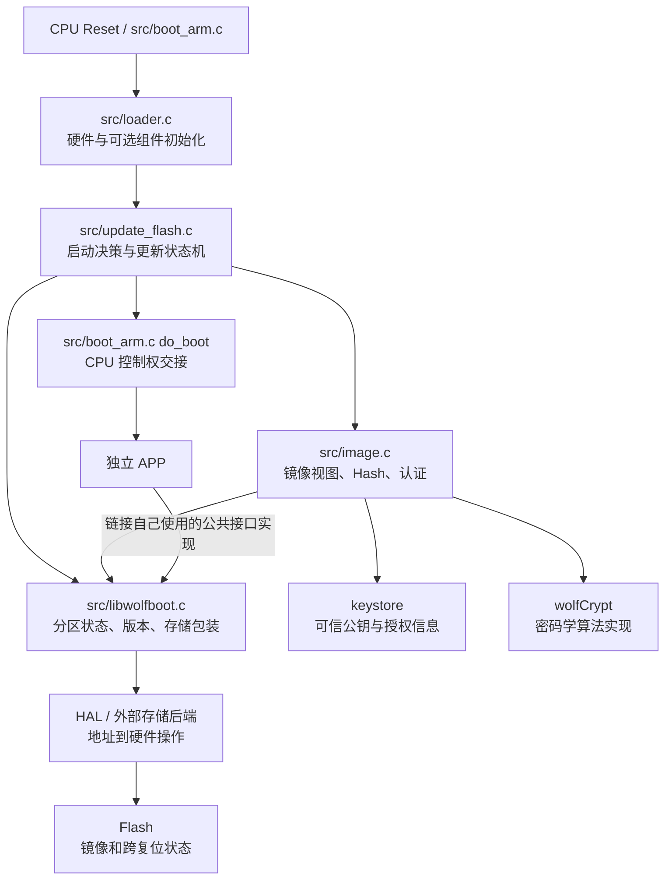
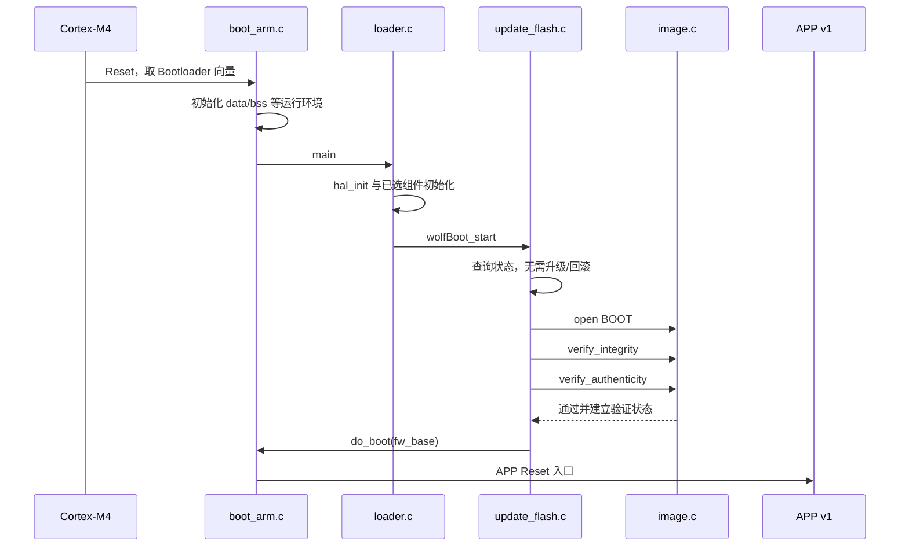
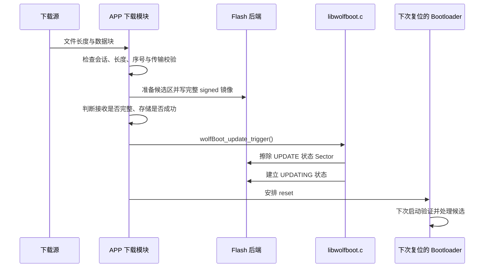
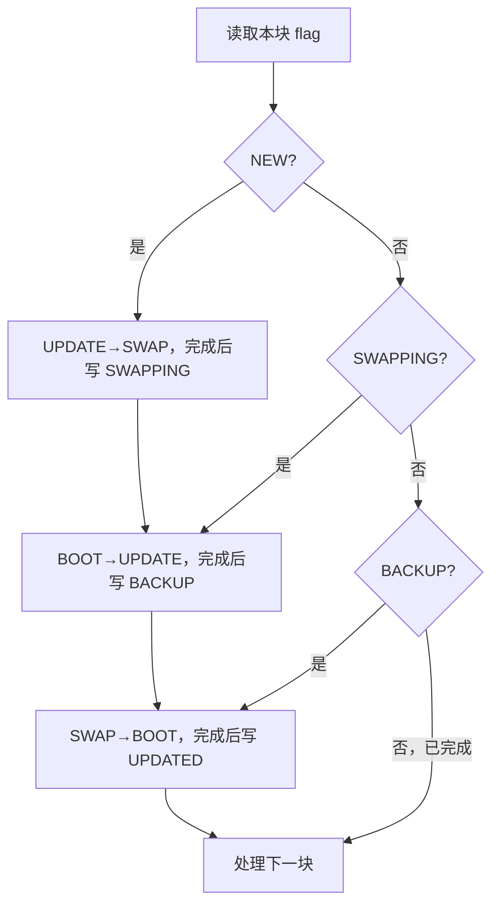
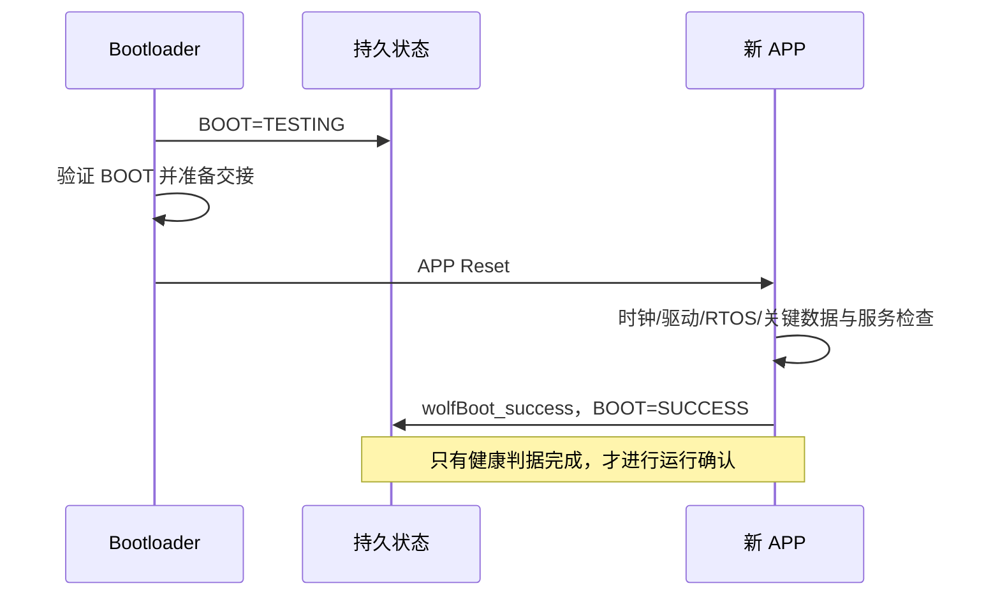
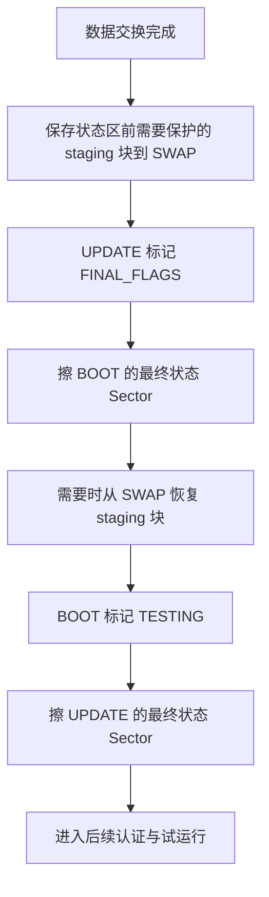

# wolfBoot 源码学习指导教程 V2.0

**面向已有 6 年嵌入式 MCU 开发经验的工程师：从系统模型、源码机制到 Bootloader 设计推理**

> 本文是一份独立的源码学习教程。先建立整体模型，再逐层解释模块、数据、关键场景与失效边界，最后将这些认识转化为面试表达。所有必要的图表、地址例子和源码入口都包含在本文中，不依赖其他配套文档。
>
> 分析基线：wolfBoot `0a3b0f7184a7a3d378e2a63b3d1e9080d03c3f8f`，wolfCrypt 所在 wolfssl 子模块 `f99453320ff306fe5bfb10788117f18c9bfeaf6b`。主线选用 **Cortex-M4 / STM32F407、内部 Flash、Ed25519 + SHA256、保留旧版备份的 Flash SWAP**。示例地址采用 STM32F407ZGT6、1MiB Flash 假设，不代表探索者实板已验证。本文不新增编译或硬件测试结论。

---

## 阅读路线：先长出枝干，再把细节挂上去

你已有的驱动、启动文件、链接脚本、中断与 Flash 经验足够成为入口。需要补齐的主要不是更多寄存器，而是三种跨模块思维：**信任从哪里来、跨复位的事务怎样继续、两套固件怎样履行同一个契约。**

全文分为四层：

| 层次 | 要建立的认识 | 对应章节 |
|---|---|---|
| 第一层：系统枝干 | wolfBoot 解决什么问题，整体由哪些部分组成 | 1～3 |
| 第二层：模块与数据 | 镜像、认证、Flash、状态、跳转各自怎样工作 | 4～6 |
| 第三层：核心场景 | 启动、下载、升级、确认、回滚、断电恢复如何串起来 | 7～9 |
| 第四层：设计与表达 | 设计模式、难点、产品取舍、源码阅读和面试推理 | 10～13 |

第一次读，先完成第 1～3 章，不追每个函数。第二遍结合第 4～9 章，把“一个有效镜像从生成到运行”的过程讲完整。第三遍再用第 10～13 章检查自己能否解释失败路径和设计取舍。

一个合适的学习终点是：不看文档也能画出组件图、Flash 布局、三步交换图，并说明每一步掉电后哪份数据仍然可用。能做到这些，才算理解了核心机制；仅记住函数名还不够。

---

# 第一层：建立整个系统的枝干

## 1．wolfBoot 的本质：复位时执行的镜像决策器

### 1.1 从你熟悉的普通 MCU 工程迁移

普通 MCU 应用的启动过程通常是：

```text
CPU 复位 → 取初始栈和 Reset 向量 → 初始化 C 运行环境 → main → 业务循环
```

加入 wolfBoot 后，前面多了一个拥有独立启动文件和链接结果的固件：

```text
CPU 复位
  → Bootloader 自己启动
  → 处理上一轮未完成的更新或试运行
  → 判断哪个镜像可以被执行
  → 认证将要执行的镜像
  → 交接 CPU 环境
  → APP 自己启动
```

因此，wolfBoot 可以先理解成：**在复位这个相对可控的时间窗口里，管理镜像资格与替换过程的状态机。**

它有两项主要责任：

1. **执行准入**：待执行镜像的结构、内容和签名是否满足策略。
2. **更新恢复**：新旧镜像替换时，即使发生中断，也保留足以继续或恢复的数据与状态。

你过去写一个 Flash 驱动，重点是“这次擦写是否完成”；这里再往上一层，重点变成“设备复位后，能否知道上次做到哪里、接下来该相信谁”。

### 1.2 分清四个容易混在一起的问题

| 问题 | 回答它的机制 | 单独具备它不能保证什么 |
|---|---|---|
| 文件传完整了吗？ | 长度、分包序号、传输校验、重传 | 不能证明发布者被授权 |
| 内容被改变了吗？ | Hash 与受保护的签名关系 | 单独一个可随意替换的 Hash 不能阻止恶意修改 |
| 谁授权这个版本运行？ | 数字签名、可信公钥、镜像类型权限、版本策略 | 不能证明 APP 的业务逻辑一定正常 |
| 新版运行正常吗？ | APP 健康检查、确认、watchdog、回滚 | 不能替代密码学认证 |

这四个问题对应不同模块。把它们区分开，架构就会自然清晰。

### 1.3 wolfBoot 的系统边界

wolfBoot 核心处理镜像认证、启动和更新机制。产品下载通道、云端发布服务、业务自检、量产密钥管理与复位策略，需要集成者完成。

例如，你可以在 APP 中通过以太网下载，也可以由调试器将镜像放进 UPDATE。只要最终满足相同的镜像与状态契约，复位后的更新机制可以相同。反过来，即使 UART 传输完全正确，写错分区或确认策略不当，更新仍然可能失败。

**本章应该能复述的一句话：** wolfBoot 管理“什么可以运行”和“替换过程怎样恢复”；产品 APP 与发布系统还要管理“怎样收到它”和“怎样确认它运行健康”。

## 2．整体组成：先认清三个参与者、两个镜像、五条契约

### 2.1 三个参与者


这不是运行在同一时刻的三个线程。主机在设备外；Bootloader 和 APP 一般分阶段取得 CPU 控制权，靠 Flash 中的数据和状态跨复位协作。

### 2.2 两个独立固件镜像

Bootloader 和 APP 分别拥有：启动入口、链接地址、代码段、数据段、栈规划、ELF 和二进制产物。

上游顶层 Makefile 可以替你调用 test-app 子目录，但这只是构建编排。**APP 没有因此变成 Bootloader 的一个普通链接模块。**

APP 可以继续使用自己的 CMake、Make 或 CubeIDE 工程。需要协调的是镜像契约，不是强行共用一个工程文件。

### 2.3 五条跨边界契约

| 契约 | 必须一致的内容 | 不一致的典型结果 |
|---|---|---|
| 地址契约 | Boot、BOOT、UPDATE、SWAP、APP 向量地址、RAM 范围 | 错擦、覆盖运行区、跳转 HardFault |
| 格式契约 | 头大小、TLV、长度、镜像类型、端序 | Header 解析或类型校验失败 |
| 密码契约 | Hash、签名算法、可信公钥、授权范围 | 摘要或认证失败 |
| 状态契约 | 下载完成、请求更新、试运行、确认、恢复标记 | 不升级、反复回滚、把半包当候选 |
| CPU 交接契约 | VTOR、MSP、入口、IRQ、时钟、watchdog、外设状态 | APP 能进入 main 却异常中断或复位 |

后面几乎所有难点都能挂回这五条契约。面试中先说清这些接口边界，会比直接罗列一串 API 更有说服力。

## 3．静态架构：谁做决策，谁解释数据，谁操作硬件

### 3.1 用职责建立组件图



这是职责与调用关系图，不代表所有代码严格排成单向的五层。`image.c` 会使用 `libwolfboot.c` 中的头/分区辅助函数，更新层也会使用存储包装；不要为追求漂亮分层而忽略真实依赖。

### 3.2 模块接口总表

| 模块 | 对上提供的能力 | 输入和输出 | 依赖与关键边界 |
|---|---|---|---|
| `src/loader.c` | C 入口与一次性初始化 | 从 reset 接手，调用 `wolfBoot_start()` | HAL、所选可选外设；默认入口名为 `main` |
| `src/update_flash.c` | 复位决策、交换、回滚、恢复 | 镜像状态 → 存储操作 → 待启动镜像 | image、公共状态接口、Flash 包装、`do_boot` |
| `src/image.c` | 打开镜像、验证完整性和真实性 | Flash 字节 → `wolfBoot_image` → 认证结果 | 头解析、keystore、wolfCrypt |
| `src/libwolfboot.c` | 版本/状态接口和存储辅助 | 分区 ID、状态值、偏移 → 元数据读写 | 配置宏、内部 HAL 或外部后端 |
| `hal/stm32f4.c` | 时钟、Flash 擦写与锁、缓存处理 | 地址/长度/数据 → 硬件动作 | RCC、FLASH、真实 Sector 几何 |
| `src/boot_arm.c` | C 运行环境建立、跨镜像交接 | 链接符号、APP 向量地址 → CPU 状态变化 | Cortex-M 架构、MPU、VTOR、MSP |
| `tools/keytools/` | 主机密钥生成和签名 | APP 裸二进制、私钥、版本 → 签名镜像 | 主机环境和 wolfCrypt |

源码入口：[loader.c](https://github.com/wolfSSL/wolfBoot/blob/0a3b0f7184a7a3d378e2a63b3d1e9080d03c3f8f/src/loader.c)、[update_flash.c](https://github.com/wolfSSL/wolfBoot/blob/0a3b0f7184a7a3d378e2a63b3d1e9080d03c3f8f/src/update_flash.c)、[image.c](https://github.com/wolfSSL/wolfBoot/blob/0a3b0f7184a7a3d378e2a63b3d1e9080d03c3f8f/src/image.c)、[libwolfboot.c](https://github.com/wolfSSL/wolfBoot/blob/0a3b0f7184a7a3d378e2a63b3d1e9080d03c3f8f/src/libwolfboot.c)。

### 3.3 最容易误解的 APP 接口：共享源码，不是跨镜像 RPC

APP 调用 `wolfBoot_success()`，通常是 APP 自己链接的 `libwolfboot.c` 实现在写 Flash 状态。它不是默认跳进 Bootloader 区的固定函数地址。

这与你在不同固件中都链接同一套驱动库类似：源码和接口复用，运行代码各自属于所在镜像。这样可以降低 APP 对 Bootloader 内部符号地址和编译布局的耦合。

代价是双方必须使用一致的分区和状态配置。函数名相同，不代表使用不同 `.config` 编出来就能安全互操作。

### 3.4 构建系统本身在做“静态装配”

当前主线配置是 GNU Make 变量文件。顶层读取 `.config`，通过 `tools/config.mk`、`arch.mk`、`options.mk` 选择 CPU、HAL、密码算法、对象和更新后端，生成 `include/target.h` 与链接脚本等产物。

它不应被简单描述为“和 Linux 一模一样的 Kconfig”。相似处在于配置驱动编译裁剪；具体配置语言和生成链路要看仓库本身。

```text
.config
  ├─ ARCH/TARGET → CPU 指令集、工具链、HAL、链接模板
  ├─ SIGN/HASH   → 镜像算法、密码库对象、头部要求
  ├─ 分区参数    → 生成地址、长度、APP 链接入口
  └─ 功能开关    → 选入/裁去不同更新与平台分支
```

这意味着很多“策略选择”在编译时完成。阅读源码前先限定配置，可以把大量无关 `#ifdef` 暂时折叠；否则会把 RAM boot、硬件双 Bank、外部加密和普通 Flash SWAP 混成一条不存在的路径。

本教程后续始终沿用一个固定配置分支，讨论其他模式时明确另列。

---

# 第二层：把核心模块和数据结构读透

## 4．镜像与认证：从一段字节到“可以执行”的对象

### 4.1 先区分三个不同的“镜像”

| 对象 | 用途 | 不能混淆的地方 |
|---|---|---|
| ELF | 链接结果与调试信息，记录段地址和符号 | 不等于普通模式下直接放入分区的签名格式 |
| APP raw binary | 真正的向量表、代码和数据初值 | 开头通常是 MSP/Reset 向量，没有 wolfBoot 头 |
| signed binary | wolfBoot 头 + APP raw binary | 分区起点是镜像头，向量表在头之后 |

假设 BOOT 分区从 `0x08020000` 开始，头大小为 256B：

```text
0x08020000  镜像头：magic / 长度 / TLV
0x08020100  APP 向量表：MSP / Reset / 其他异常入口
后续地址    APP 指令、只读数据、RAM 数据初值
分区尾部    独立于签名内容管理的持久化状态
```

APP 的 FLASH 链接起点应是 `0x08020100`，不是 `0x08020000`。如果升级后仍从固定 BOOT 地址执行，暂存于 UPDATE 的 APP 也按 BOOT 地址链接，交换到位后才运行。

### 4.2 头部是协议，C 结构体是运行时视图

普通镜像头先放 magic 和固件长度，再放 TLV。TLV 中有版本、时间、镜像类型、Hash、公钥 hint、签名等字段；实际排列和长度由签名工具及算法决定，剩余空间按格式填充。

本配置有两个重要数值：

- 小端镜像 magic 为 `0x464C4F57`，内存字节呈现为 `WOLF`。
- 固件长度 `fw_size` 表示原始 payload 大小，不含镜像头。

`struct wolfBoot_image` 则是运行时对象，典型字段为：

| 字段 | 含义 | 常见误读 |
|---|---|---|
| `hdr` | 当前镜像头地址 | 地址存在不表示头可信 |
| `fw_base` | APP payload 起点 | 这里首先是向量表，不是直接可执行的第一条指令 |
| `fw_size` | payload 长度 | 不等于分区容量或 signed 文件总长 |
| `trailer` | 与分区尾部相关的位置视图 | 实际状态字节位置仍由 trailer 访问规则决定 |
| `sha_hash` | 已验证/计算摘要的关联指针 | 是运行期状态，不是永久安全凭证 |
| `part` | BOOT/UPDATE/SWAP 等存储角色 | 不等于签名头中的应用授权类型编号 |
| `hdr_ok/sha_ok/signature_ok` | 不同阶段的验证状态 | 不能把第一个标志视为“全部认证通过” |

这个结构体不能被当作文件协议直接 `memcpy` 保存。指针、bitfield、平台加固字段和条件编译都不是稳定的磁盘格式。

源码：[include/image.h](https://github.com/wolfSSL/wolfBoot/blob/0a3b0f7184a7a3d378e2a63b3d1e9080d03c3f8f/include/image.h)、[公共镜像常量与接口](https://github.com/wolfSSL/wolfBoot/blob/0a3b0f7184a7a3d378e2a63b3d1e9080d03c3f8f/include/wolfboot/wolfboot.h)。

### 4.3 为什么分成 open、integrity、authenticity 三步


**第一步：`wolfBoot_open_image()`。**

它根据分区角色建立地址视图，清理结构体状态，调用 `wolfBoot_open_image_address()` 校验 magic、长度等基础条件，并形成 payload 起点。这里的 open 是“能否按该格式继续处理”，不是安全认证完成。

SWAP 是特别重要的例外：`PART_SWAP` 被当作交换工作区打开，函数直接按配置建立视图，不要求它此刻就是完整可认证 APP。因而 `open_image(SWAP)` 成功不能证明 SWAP 内容可信；恢复路径还需自己的检查。

**第二步：`wolfBoot_verify_integrity()`。**

它先清理旧的 `sha_ok` 与摘要关联，再重新读取 Hash TLV、计算摘要并比较。这个清理顺序用于避免复用结构体时上次成功标志残留。

**第三步：`wolfBoot_verify_authenticity()`。**

它读取签名、公钥 hint、镜像类型，确认算法/权限/签名长度，必要时补做完整性校验，然后调用实际签名验证实现。只有相关验证状态成立，后续策略才有理由接受镜像。

对应源码：[open_image_address](https://github.com/wolfSSL/wolfBoot/blob/0a3b0f7184a7a3d378e2a63b3d1e9080d03c3f8f/src/image.c#L1585)、[open_image](https://github.com/wolfSSL/wolfBoot/blob/0a3b0f7184a7a3d378e2a63b3d1e9080d03c3f8f/src/image.c#L1770)、[integrity](https://github.com/wolfSSL/wolfBoot/blob/0a3b0f7184a7a3d378e2a63b3d1e9080d03c3f8f/src/image.c#L1961)、[authenticity](https://github.com/wolfSSL/wolfBoot/blob/0a3b0f7184a7a3d378e2a63b3d1e9080d03c3f8f/src/image.c#L2653)。

### 4.4 Hash 究竟覆盖什么：这是必须说准确的细节

本配置中，`header_sha256()` 找到 Hash TLV 的位置，将其 **TLV 起点之前的头部前缀**加入 Hash；`image_sha256()` 再加入 payload 的 `fw_size` 字节。

可以用下面的关系理解，注意它不是可替换所有模式的通用代码：

```text
镜像摘要 = SHA256（头部前缀，截止于 Hash TLV 之前 || payload）
```

所以：

1. 不能说“只对 APP 代码算 Hash”，因为版本等头部元数据也受到该格式的认证关系保护。
2. 不能说“对整个 signed 文件算 Hash”，因为 Hash/签名字段不能循环包含自身。
3. 主机和设备必须以相同顺序、相同字节范围计算；自己重新实现签名工具最容易在这里出错。
4. 不能推导为头中每一个可能存在的 TLV 都无条件进入相同 Hash 范围；必须查看其所在位置和该字段的独立校验方式。

本配置将得到的镜像摘要作为 Ed25519 签名验证的消息输入。Ed25519 自身还用到 SHA512，因此构建中存在 `sha512.c` 不意味着外层镜像 Hash 从 SHA256 变成了 SHA512，也不要未经源码确认就称它是 Ed25519ph。

源码：[header_sha256 / image_sha256](https://github.com/wolfSSL/wolfBoot/blob/0a3b0f7184a7a3d378e2a63b3d1e9080d03c3f8f/src/image.c#L1166)、[Ed25519 验证适配](https://github.com/wolfSSL/wolfBoot/blob/0a3b0f7184a7a3d378e2a63b3d1e9080d03c3f8f/src/image.c#L211)、[主机签名工具](https://github.com/wolfSSL/wolfBoot/blob/0a3b0f7184a7a3d378e2a63b3d1e9080d03c3f8f/tools/keytools/sign.c)。

### 4.5 公钥 hint 不等于公钥授权

设备的可信公钥来自 keystore。镜像中的 hint 用于选择其中一个 key slot，不是让镜像自行提交一个“请相信我”的公钥。

认证时还会读取 key slot 的 mask，检查该密钥是否获准认证头中声明的目标类型/分区身份。这里要分清两个命名空间：

- `PART_BOOT=0`、`PART_UPDATE=1`、`PART_SWAP=2` 是内部存储角色。
- 签名头的 APP 类型/授权分区 ID 是认证策略的一部分，普通 APP 的标识可以是 1，不能因此说它只能放进内部 `PART_UPDATE`。

同一个 APP 镜像先在 UPDATE 认证、交换后在 BOOT 认证，正说明“存放位置”和“被授权的镜像用途”不是同一个概念。

### 4.6 一个高级工程师应该从解析器追问什么

TLV 不是难在循环读取 Type-Length-Value，而是它面对攻击者可控数据：

- 长度是否超过头部边界，计算是否可能溢出？
- 端序、对齐和字段宽度是否明确？
- 缺字段、长度错误、重复字段时采用什么规则？
- 版本和类型在被用于决策前，是否已经建立相应信任？
- 候选完整镜像和交换中断后的局部头，允许使用的校验条件是否不同？

不要先假定实现拒绝所有重复字段。应直接查看 `wolfBoot_find_header()` 的扫描与返回规则，再分析签名工具和读取端是否存在解释差异。

源码：[wolfBoot_find_header](https://github.com/wolfSSL/wolfBoot/blob/0a3b0f7184a7a3d378e2a63b3d1e9080d03c3f8f/src/libwolfboot.c#L1358)。

## 5．Flash 与持久状态：把一次更新变成跨复位事务

### 5.1 三种粒度必须分清

| 粒度 | 决定什么 | 在 F407 上的意义 |
|---|---|---|
| 硬件擦除粒度 | 一次擦除会破坏哪些地址 | 前面有 16KiB/64KiB，后面主要为 128KiB Sector |
| 硬件编程粒度与限制 | 数据怎样从 1 写成 0，能否重复写同一单元 | 取决于 Flash 控制器、供电和具体写法 |
| 算法交换粒度 | 更新状态机一次周转多大块 | `WOLFBOOT_SECTOR_SIZE`，必须与所覆盖的擦除几何协调 |

配置一个 4KiB 软件块，不会让 F407 的 128KiB Sector 变小。若两个逻辑分区共用一个真实擦除 Sector，擦候选区可能把当前 APP 或状态也擦掉。

### 5.2 一张足够解释原理的布局

本教程使用以下 1MiB Flash 布局：

| 区域 | 地址范围 | 大小与职责 |
|---|---|---|
| Bootloader | `0x08000000～0x0801FFFF` | 128KiB；跨 S0～S4 的预留区域 |
| BOOT | `0x08020000～0x0805FFFF` | 256KiB；第一块存头+APP，末块保留状态 |
| UPDATE | `0x08060000～0x0809FFFF` | 256KiB；第一块存候选/之后的旧版备份，末块保留状态 |
| SWAP | `0x080A0000～0x080BFFFF` | 128KiB；逐块交换的临时工作区 |
| 未使用 | `0x080C0000～0x080FFFFF` | 本学习布局不使用 |

这是一种便于分析的配置，不是所有 wolfBoot 平台的固定布局。

### 5.3 “分区有 256KiB”不等于“APP 可用 256KiB”

当前基线的普通 Flash SWAP 更新上限为：

```text
MAX_UPDATE_SIZE = 分区大小 − IMAGE_HEADER_SIZE − WOLFBOOT_SECTOR_SIZE
```

上述布局下：`0x40000 − 0x100 − 0x20000 = 0x1FF00`，原始 APP 最大 **130816 字节**。

还要注意，`open_image_address()` 的基础长度检查与 `wolfBoot_update()` 的更新容量检查不是同一层规则。前者能解析某个镜像，不意味着它一定满足更新过程保留状态扇区的容量要求。应用链接器、下载器、签名/发布工具和 Bootloader 都应对容量契约保持一致。

当前锁定源码的官方 Discovery 示例仍使用一个 Sector 大小的 slot；与这里的完整状态 Sector 保留策略一起阅读时，应重新评估，不能照搬后直接宣称支持有用大小的普通更新。这是版本核对的问题，不能推广为所有旧版本或平台都采用相同限制。

源码：[MAX_UPDATE_SIZE 和恢复辅助](https://github.com/wolfSSL/wolfBoot/blob/0a3b0f7184a7a3d378e2a63b3d1e9080d03c3f8f/src/update_flash.c#L929)、[官方 Discovery 配置](https://github.com/wolfSSL/wolfBoot/blob/0a3b0f7184a7a3d378e2a63b3d1e9080d03c3f8f/config/examples/stm32f407-discovery.config)。

### 5.4 为什么状态需要 trailer magic

设备刚擦除时末尾全是 FF。仅看到一个 FF 字节，无法区分“合法 NEW 状态”“从未建立状态”“该区域不是当前布局的数据”。

因此状态读取还要检查尾部 magic。`wolfBoot_get_partition_state()` 返回失败，不应该只凭输出变量的数值继续判断。

普通、未加密、`TRAILER_SKIP=0` 的默认布局可以按下面理解；启用其他后端或自定义 trailer 时不能照抄地址：

```text
分区末尾 end
  end-4 ... end-1  trailer magic
  end-5           分区 state
  end-6 向前       UPDATE 的交换块 flags，两个 nibble 共一字节
```

以上述 UPDATE 为例，end=`0x080A0000`，magic 位于 `0x0809FFFC`，state 位于 `0x0809FFFB`。工程中应通过接口操作，地址例子用于理解，不建议 APP 硬编码它们。

### 5.5 两套状态机不能混成一套

**第一套：分区级状态。** 它回答设备下次复位应该做什么。

| 状态 | 默认数值 | 解释 |
|---|---:|---|
| NEW | FF | 初始状态，仍需有效 magic 才可按合法 trailer 解释 |
| UPDATING | 70 | UPDATE 中候选已准备好，请求更新 |
| FINAL_FLAGS | 30 | 正在做最后的状态擦除/恢复处理 |
| TESTING | 10 | BOOT 中新版需要试运行确认 |
| SUCCESS | 00 | BOOT 中版本已经确认 |

这些名字不表示所有值都在同一分区的同一字节上按表从上到下依次发生。UPDATING/FINAL_FLAGS 主要描述候选侧流程，TESTING/SUCCESS 描述启动侧确认。

**第二套：交换块级进度。** 它回答某块数据的三步交换完成了哪一步。

| flag | nibble 值 | 已完成的事实 |
|---|---:|---|
| NEW | F | 本块尚未完成新数据周转 |
| SWAPPING | 7 | 新 UPDATE 块已经复制到 SWAP |
| BACKUP | 3 | 旧 BOOT 块已经复制到 UPDATE |
| UPDATED | 0 | SWAP 中的新块已经写入 BOOT |

`F→7→3→0` 主要按 1→0 变化，顺应 NOR Flash。重置状态需要擦除或相应后端支持，不能靠写回 FF 完成。

两个 flag 共用一个字节，修改一个 nibble 时要保留另一个；这又受到实际硬件重复编程能力约束。`NVM_FLASH_WRITEONCE` 分支采用不同的状态维护方式，不能用默认 F407 的字节写思路推广到所有 MCU。

源码：[状态常量](https://github.com/wolfSSL/wolfBoot/blob/0a3b0f7184a7a3d378e2a63b3d1e9080d03c3f8f/include/wolfboot/wolfboot.h#L634)、[状态与 sector flag 访问](https://github.com/wolfSSL/wolfBoot/blob/0a3b0f7184a7a3d378e2a63b3d1e9080d03c3f8f/src/libwolfboot.c#L738)。

### 5.6 HAL 的“成功”必须代表真实硬件完成

上层状态机依赖一个关键契约：只有底层数据操作确实完成，才能提交进度标记。

若 HAL 在编程失败后仍返回成功，上层即使状态顺序完全正确，也可能把损坏的数据记为完成。当前 F4 HAL 的忙等待、错误位清理、返回值传播与缓存失效，都值得独立审查；不能因它来自官方示例就推断所有硬件错误已完整向上传递。

本基线中 `hal_flash_lock()` 还会调用缓存失效处理。原因是写后通过 Flash 映射回读时，缓存可能保留旧字节。对这种旧数据做恢复决策或 Hash，可能产生非常隐蔽的错误。

RAM 函数同样要沿完整依赖链检查：函数放 RAM，不等于它调用的函数、读取的常量、ISR 和向量也都在 RAM。单 Bank Flash 擦写期间，实时响应和 watchdog 仍需评估。

源码：[F4 HAL](https://github.com/wolfSSL/wolfBoot/blob/0a3b0f7184a7a3d378e2a63b3d1e9080d03c3f8f/hal/stm32f4.c)。

## 6．启动与交接：两个 C 程序之间不是一次普通函数调用

### 6.1 Bootloader 自己如何起来

`src/boot_arm.c` 的 `isr_reset` 根据链接符号复制 `.data`、清 `.bss`，完成相关 CPU 初始化后调用 C 入口。

`src/loader.c` 在默认 ARM 配置下提供的是 **`main()`**；只有定义 `WOLFBOOT_LOADER_MAIN` 的分支才使用 `loader_main()`。看到教程称“loader 入口”不代表二进制一定有 `loader_main` 符号。

入口中进行 `hal_init()`、所选可选组件初始化，再进入 `wolfBoot_start()`。TPM、UART_FLASH 等未启用时不是必经链路。

### 6.2 为什么不能直接跳到 APP 分区起点

本配置分区起点存镜像头；头之后才是 APP 向量表。而向量表第一个字是初始栈值，第二个字才是带 Thumb 状态信息的 Reset 入口。

```text
fw_base + 0：APP 初始 MSP
fw_base + 4：APP Reset 入口
```

因此最终交接需要从向量表取值，设置 CPU 环境，再跳向真正的 Reset 入口。把 `fw_base` 强转函数指针直接调用，会把向量表数据当作指令。

### 6.3 当前 `do_boot()` 实际做了什么

在 Armv6/v7 分支中，代码关闭 MPU；按 VTOR 配置处理 IRQ 和向量表；取 APP MSP、入口；切换 MSP；恢复相应中断状态；转移 PC。

必须注意两点：

1. 这是一段具体实现，不是完整产品交接清单。不能据此声称所有 NVIC pending、SysTick、DMA、watchdog 和外设都已经恢复到硬复位状态。
2. 当前分支会在最终跳转前重新允许中断。若集成环境残留了不合适的 pending IRQ，交接窗口和 APP 启动期都需要分析；不要把自己的理想交接代码误写成上游已经做的动作。

设置 MSP 后的汇编与 C 编译器生成代码之间也有约束：不能把它当作普通函数返回，之后随意继续使用原栈局部变量。理解这点比背三行寄存器设置更重要。

源码：[reset 入口](https://github.com/wolfSSL/wolfBoot/blob/0a3b0f7184a7a3d378e2a63b3d1e9080d03c3f8f/src/boot_arm.c#L263)、[do_boot 的 M4 对应分支](https://github.com/wolfSSL/wolfBoot/blob/0a3b0f7184a7a3d378e2a63b3d1e9080d03c3f8f/src/boot_arm.c#L614)。

### 6.4 你自己的 APP 还要检查什么

| 项目 | 需要回答的问题 |
|---|---|
| 链接器 | 向量表是否放在 BOOT+头大小？payload 上限是否预留状态 Sector？ |
| SystemInit | 是否又把 VTOR 无条件写回 0x08000000？ |
| 中断 | 外设中断源、NVIC enable/pending、优先级、SysTick 谁清理/重建？ |
| 栈与模式 | MSP/PSP/CONTROL、栈对齐是否符合本平台启动前提？ |
| 时钟 | APP 是否重建时钟？Bootloader 是否按配置 restore clock？ |
| DMA/缓存 | 是否有跨镜像残留传输、缓存或内存一致性问题？ |
| watchdog | 已启动的 watchdog 是否可关闭？交接与认证期间如何喂狗？ |

这张表是产品评审清单，不是宣称上游所有平台都缺少这些处理。不同 target、架构与配置拥有不同的前提，必须核对实际分支。

**这一层的自检：** 能否不看代码解释 open/Hash/认证为什么分开；状态为何有两套；跳转为何必须同时处理向量表和栈？

---

# 第三层：用核心场景把模块串起来

## 7．一条正常生命周期：首启、下载、认证、启动

### 7.1 先看 `wolfBoot_start()` 的决策骨架

下面是帮助阅读的概念化伪代码，省略了可选组件和错误细节，不是上游源码逐字摘录：

```text
读取 BOOT 和 UPDATE 状态
尝试恢复未完成的最终状态处理

如果本次不属于刚完成最终阶段恢复的情况：
    如果 BOOT 是 TESTING：尝试失败回滚
    否则如果 UPDATE 是 UPDATING：尝试正常更新

打开当前 BOOT 镜像
校验完整性和真实性
如果 BOOT 不合法：尝试紧急恢复候选，再验证恢复结果
若没有合法启动选择：panic

准备硬件/CPU交接
do_boot(APP 向量地址)
```

要特别留意真实实现对最终阶段恢复返回值的处理：它需要区分“本次刚恢复出一个待试运行镜像”与“上次试运行后再次 reset”。否则刚写好的 TESTING 就会在同一次启动中被误判为试运行失败。

在本配置的真实条件中，先缓存读取到的 `bootRet/bootState`，再调用最终恢复函数；只有 `resumedFinalErase != 0` **或先前已经读到有效的 BOOT=TESTING** 时，才进入后面的回滚/更新判断块。理解这一点要把返回值、本次已执行动作和读取状态的时刻一起看；不能简单重写成“任何时候读到 TESTING 就立刻回滚”。

这里体现了一个通用原则：**同一个持久状态，结合本次启动已经发生的动作，可能具有不同的决策含义。** 只读一张状态枚举表不足以复原流程。

源码：[wolfBoot_start](https://github.com/wolfSSL/wolfBoot/blob/0a3b0f7184a7a3d378e2a63b3d1e9080d03c3f8f/src/update_flash.c#L1697)。

### 7.2 场景一：第一次启动工厂镜像

前提：工厂已放好合法 Bootloader 和 BOOT v1，UPDATE/SWAP/状态区处于已知初始状态。



首启并不要求 BOOT 必须先有 SUCCESS trailer。镜像头和状态尾部承担不同职责：有效签名镜像可以存在，而状态区尚未建立 magic。实际启动逻辑会综合判断，不能把“state 读取失败”直接翻译成“固件签名失败”。

### 7.3 场景二：APP 下载候选，何时算提交



这里可以区分两个提交点：

- **下载提交**：完整候选已落盘，并请求 Bootloader 在复位时处理。
- **运行提交**：新版实际运行并完成健康确认，旧版不再作为本轮试运行的默认回滚选择。

`wolfBoot_update_trigger()` 的职责属于前者；`wolfBoot_success()` 属于后者。它们之间隔着认证、交换、跳转和业务自检。

当前 `wolfBoot_update_trigger()` 会擦候选末尾状态 Sector，因此容量限制必须在下载阶段已经满足。API 不是“把某个布尔变量设为 true”那么简单。

还必须考虑上次遗留状态：若 UPDATE 仍为 UPDATING，新的下载尚未完成就 reset，Bootloader 可能按旧状态处理这片区域。产品下载模块应定义开始会话时的候选区和状态准备规则，而不是只在最后补一个 trigger。

源码：[update_trigger](https://github.com/wolfSSL/wolfBoot/blob/0a3b0f7184a7a3d378e2a63b3d1e9080d03c3f8f/src/libwolfboot.c#L893)。

### 7.4 场景三：候选认证失败，设备应该怎样表现

正常更新路径会在破坏当前 BOOT 前检查候选类型、容量、完整性、真实性和版本策略。

| 输入情况 | 应定位的失败层 | 设备的合理后续 |
|---|---|---|
| magic 错、长度越界 | 镜像基础解析 | 拒绝候选；若 BOOT 合法则继续旧版 |
| payload 被修改 | 完整性验证 | 不交换，继续认证现有 BOOT |
| 用另一把未授权私钥签名 | 公钥 hint/授权/签名验证 | 不交换；Hash 正确也不够 |
| 用可信密钥签了旧版本 | 正常更新版本策略 | 拒绝普通降级，不能误认为签名无效 |
| BOOT 和可用恢复候选都不合法 | 启动与紧急恢复路径 | 进入 panic，不跳进未认证 APP |

“错误候选被拒绝”与“整机拒绝所有启动”是两个不同结果。旧版仍可合法运行时，继续旧版是可用性与安全性共同要求的行为。

## 8．SWAP 更新与试运行：理解真正的数据搬迁

### 8.1 用一个块的内容解释整个算法

记旧 BOOT 块为 O，新 UPDATE 块为 N。当前基线的三步是：

```text
① UPDATE → SWAP    先保住新块 N
② BOOT   → UPDATE  再把旧块 O 放入原候选位置
③ SWAP   → BOOT    最后把新块 N 放进固定执行地址
```

| 已提交进度 | BOOT | UPDATE | SWAP | 下一步依赖什么 |
|---|---|---|---|---|
| NEW | O | N | 不要求有效 | 从 UPDATE 建立新块副本 |
| SWAPPING | O | N 或正在被覆盖 | N | 旧 BOOT 与新 SWAP |
| BACKUP | O 或正在被覆盖 | O | N | 旧 UPDATE 与新 SWAP |
| UPDATED | N | O | N | 进入下一块/最终阶段 |

这张表比“把 A/B 交换一下”更重要，因为它直接说明每次擦除为什么有依据。

**特别注意顺序：本版本先 UPDATE→SWAP。** 有些其他实现先备份旧块，但不能用别的算法记忆代替这里的源码。

### 8.2 `wolfBoot_update()` 的职责分段

可以按下面五段读这个较长函数：

1. **恢复上下文**：打开 BOOT/UPDATE/SWAP，必要时从 SWAP 恢复被破坏的候选头信息。
2. **建立范围**：计算需要交换的总长度，考虑新旧镜像长度不同。
3. **首次更新准入**：在新的交换开始前验证类型、容量、Hash、签名和版本。
4. **按 flag 逐块推进**：完成三步数据交换并记录每步进度。
5. **清理与最终状态处理**：清除不再使用的数据区，处理 trailer 所在 Sector，建立试运行状态。

不是进入函数的每一次调用都会拥有一份放在原位置、完整连续的新镜像。恢复分支和首次更新分支有不同前提，所以不能把完整镜像准入检查机械地强塞到每次重入最前面。

源码：[wolfBoot_update](https://github.com/wolfSSL/wolfBoot/blob/0a3b0f7184a7a3d378e2a63b3d1e9080d03c3f8f/src/update_flash.c#L1046)。

### 8.3 switch 的 fall-through 为什么合理

源码按 sector flag 分支。在 NEW 分支完成 UPDATE→SWAP 后，可继续执行 SWAPPING 分支；再完成备份后，可继续 BACKUP 分支。这是主动的阶段推进，不代表每个阶段都必须等待一次 reset。



这个图省略了错误返回；真实源码中 copy 失败会停止本次推进，不能在失败后继续提交后续 flag。

### 8.4 为何只需一个 Sector 的 SWAP

SWAP 是一块循环使用的周转空间。BOOT/UPDATE 使用当前 `sector` 的偏移，SWAP 总是使用自身的临时块位置。完成一块后，再用它服务下一块。

这降低了额外 Flash 空间需求，也避免必须把整个固件搬进 RAM。内部 Flash 路径可以直接从源地址读取，外部后端通常还需缓冲读入；具体 RAM 使用由后端、配置和 `FLASHBUFFER_SIZE` 决定，不能笼统说所有路径都分配一个 Sector 大小的 RAM。

代价是多次擦写、较长的更新窗口，以及更复杂的持久状态设计。

源码：[wolfBoot_copy_sector](https://github.com/wolfSSL/wolfBoot/blob/0a3b0f7184a7a3d378e2a63b3d1e9080d03c3f8f/src/update_flash.c#L278)。

### 8.5 为什么交换第一块后要重新读头

第一块包含镜像头。完成这一块交换后，BOOT 中是新头，UPDATE 中是旧头，原结构体里的 `fw_size` 与当前位置的关系已经变化。

源码会重开镜像视图、调整用于计算的大小，再计算总交换范围。总范围要考虑新旧两个镜像中较大的长度，否则“新版短于旧版”可能留下旧数据，或者“新版更大”没有完整搬完。

这也是理解数据视图生命周期的好例子：结构体里的指针没变，指针指向的持久内容已经变了，之前缓存的解释不能直接继续用。

### 8.6 场景四：新版第一次运行

交换成功后，BOOT 被标记 TESTING，旧版保留在 UPDATE 的有效数据区域。Bootloader 对最终准备启动的 BOOT 进行完整验证，然后交接 CPU。

此时的含义是：**密码学准入已经通过，业务健康尚未确认。**

APP 应完成有意义的自检后调用 `wolfBoot_success()`。这个调用将 BOOT 标记为 SUCCESS，改变后续复位的决策。



官方普通 F4 test-app 用“偶数版本确认、奇数版本不确认”的方式演示成功与回滚。它不是产品策略，也不意味着所有奇数工厂镜像都会回滚；仍要看 BOOT 是否处于 TESTING。

源码：[wolfBoot_success](https://github.com/wolfSSL/wolfBoot/blob/0a3b0f7184a7a3d378e2a63b3d1e9080d03c3f8f/src/libwolfboot.c#L964)、[普通 F4 APP](https://github.com/wolfSSL/wolfBoot/blob/0a3b0f7184a7a3d378e2a63b3d1e9080d03c3f8f/test-app/app_stm32f4.c)。

### 8.7 场景五：未确认后复位，回滚怎样发生

Bootloader 再次启动时发现 BOOT 仍为 TESTING，会走允许 fallback 的路径，验证并尝试将旧备份交换回来。

```text
BOOT=v2 / SUCCESS，UPDATE 准备 v3
    ↓ 正常更新
BOOT=v3 / TESTING，UPDATE 保留 v2
    ↓ v3 未确认，watchdog 或其他原因 reset
Bootloader 发现 TESTING
    ↓ 允许恢复旧版的交换路径
BOOT 恢复 v2，按相应回滚判据恢复确认状态
```

当前实现通过 `fallback_allowed` 等上下文区分正常升级、试运行失败回滚和紧急恢复。**允许恢复旧版本不等于跳过签名认证。**

正常更新通常要求版本变大；试运行失败时必须允许回到上一份可信版本。两条策略不矛盾，但必须明确谁有资格进入例外路径。

未确认本身不会在 CPU 挂住时主动执行任何代码。Bootloader 要等下一次复位才重新获得控制权。因此 watchdog、异常复位、健康确认时机是产品可靠性的组成部分。

## 9．真正的难点：交换途中断电，怎样知道该继续哪一步

### 9.1 先建立四个不变量

阅读恢复算法时，每条操作都应该用不变量检验：

1. **擦除唯一需要的数据前，必须有可恢复的另一份来源。**
2. **只有数据步骤完成后，才能写“该步骤完成”的状态。**
3. **状态落后于数据时，重新执行该步骤不会破坏剩余恢复来源。**
4. **最终跳转前，目标镜像仍要满足完整认证与相关一致性检查。**

这些是不变量层面的设计目标。它们依赖 Flash HAL 完成语义、写入粒度和实际故障模型；不能仅凭 C 代码顺序就推断所有低电压半写情况都已被证明安全。

### 9.2 场景六：每个阶段掉电，各自从哪里恢复

| 掉电时刻 | 持久化 flag | 还保有什么 | 恢复思路 |
|---|---|---|---|
| UPDATE→SWAP 尚未完成 | NEW | 新块仍在 UPDATE，旧块仍在 BOOT | 重新建立 SWAP 副本 |
| 新块已到 SWAP，flag 还没写 | NEW | UPDATE 和 BOOT 仍是原来源 | 重复第一步，代价是额外擦写 |
| flag 已 SWAPPING，正在 BOOT→UPDATE | SWAPPING | 新块在 SWAP，旧块在 BOOT | 重新完成旧块备份，再写新 BOOT |
| 已 BACKUP，正在 SWAP→BOOT | BACKUP | 旧块在 UPDATE，新块在 SWAP | 重新擦写 BOOT，不再需要原 BOOT 内容 |
| BOOT 已写完，UPDATED 尚未写 | BACKUP | SWAP 仍有新块，UPDATE 仍有旧块 | 允许重复第三步 |
| 已 UPDATED | UPDATED | 本块新旧位置已经互换 | 跳过本块，推进后续范围 |

这里的可重复性不是简单“失败就重试”。**能否重试由数据副本的位置决定，而数据副本的位置由持久化阶段标记解释。**

### 9.3 最棘手的第一块：UPDATE 头已经被擦掉

假设第 0 块已经完成 UPDATE→SWAP，flag 为 SWAPPING。随后擦 UPDATE、准备写旧 BOOT 时掉电，UPDATE 头可能不存在。

如果恢复代码只会 `open_image(UPDATE)`，它就无法得到新镜像长度，甚至无法继续恢复。当前实现提供 `wolfBoot_swap_update_size()`：在特定 SWAPPING 条件下，从 SWAP 保存的第 0 块头部获取恢复所需的信息。

但 SWAP 内容也不能无条件相信。该辅助函数会检查 magic、大小上限，以及在适用配置/正常升级上下文中的版本 TLV 和版本关系。

需要说清它的能力边界：

- 该辅助函数读的是恢复所需的部分头信息，**它本身不是一次完整新镜像验签**。
- 第一次破坏性交换之前有准入验证；恢复途中有局部合理性/策略检查；最终执行之前还有 BOOT 完整验证。
- 不能因为已有“第一次验过”的历史，就认为每次恢复输入都可以完全不检查。

本基线最新提交就涉及 SWAP 第 0 块恢复时的版本检查。这是理解恢复路径安全性的具体入口，而不是要记住一个提交说明作为面试答案。

源码：[wolfBoot_swap_update_size](https://github.com/wolfSSL/wolfBoot/blob/0a3b0f7184a7a3d378e2a63b3d1e9080d03c3f8f/src/update_flash.c#L967)、[对应恢复测试](https://github.com/wolfSSL/wolfBoot/blob/0a3b0f7184a7a3d378e2a63b3d1e9080d03c3f8f/tools/unit-tests/unit-update-flash.c)。

### 9.4 为什么三步交换之后还不算结束

当所有数据已经搬好，还要处理 BOOT/UPDATE 的状态区。它们也在 Flash 中，擦除和写标记同样会被断电打断。

危险在于：如果你先擦掉解释进度的唯一标记，再来不及建立新状态就掉电，下一次启动可能不知道自己已经完成了哪些操作。

因此当前代码另有 `wolfBoot_swap_and_final_erase(resume)`，专门处理最后的状态区事务：



`FINAL_FLAGS` 表示：SWAP 已经承载最终收尾所需的数据，重入时不能再随意重新备份而把这份数据覆盖掉。

函数还包含与外部加密、密钥/nonce 和 staging magic 相关的条件分支。本主线未启用外部加密，不能把这些可选动作全部画成必经流程。恢复判断会综合状态与适用标记。

在本教程两块 Sector 的 slot 中，staging 块就是状态 Sector 前面的那一块，因此可能正包含整个有效 APP；它的恢复并非无关紧要的擦尾动作。

源码：[wolfBoot_swap_and_final_erase](https://github.com/wolfSSL/wolfBoot/blob/0a3b0f7184a7a3d378e2a63b3d1e9080d03c3f8f/src/update_flash.c#L488)。

### 9.5 认证、掉电安全和抗恶意修改不是同一项保证

这里需要把故障模型讲清楚：

| 模型 | 假设 | 主要关注 |
|---|---|---|
| 正常断电/复位 | 持久内容可能停在一次擦写的中间 | 副本、阶段标记、可重复执行、硬件半写行为 |
| 恶意候选输入 | 下载者可控制镜像内容 | 解析边界、认证、公钥授权、版本策略 |
| 中间存储被主动篡改 | 攻击者可在认证/恢复之间改 Flash 或外部存储 | 信任边界、时间窗口、最终认证、可能的拒绝服务 |
| 故障注入 | 指令、条件或数据可受物理干扰 | 校验冗余、控制流与状态一致性、平台级防护 |

能从普通掉电继续，不自动证明能抵御任意主动篡改；签名拒绝非法执行，也不保证攻击者无法让设备不可用。这些是不同的需求。

### 9.6 怎样评价“断电安全验证”是否有分量

面试不需要声称做过你没有做过的板测。可以准确说明验证设计：

1. 覆盖每次目标擦除、每段编程、每次标记提交前后。
2. 覆盖第一块头迁移、最后状态处理以及新旧镜像长短变化。
3. 覆盖中断恢复过程中再次中断，而不只正常升级中断一次。
4. 区分调试器 reset、进程模拟和真实电源掉电；后者还涉及电压下降与 Flash 行为。
5. 记录最终启动版本、状态、镜像校验结果和是否保留至少一个合法恢复选择。

当前上游 `tools/unit-tests/unit-update-flash.c` 的模拟测试能帮助理解不变量和边界，但不能直接替代真实 MCU、Flash、供电和 watchdog 条件下的验证。本文没有执行这些新增测试。

**这一层的自检：** 能否给面试官画出 NEW/SWAPPING/BACKUP/UPDATED 的数据位置，并解释“为什么最后状态 Sector 还需要一套恢复逻辑”？

---

# 第四层：从读懂代码，走到能解释设计取舍

## 10．源码中的设计模式：从解决的问题理解，不强套类图

wolfBoot 是以 C、条件编译和显式状态为主的嵌入式系统。学习设计模式时，重点是识别机制解决了什么问题，而不是给每个函数贴一个面向对象模式名。

### 10.1 分层与端口适配：隔离决策和器件差异

更新层表达“把候选块复制到周转区”；HAL 表达“该地址对应哪个 Sector、怎样解锁、写入、擦除和失效缓存”。

这对应分层设计和硬件适配思想。外部 Flash 还通过相应访问包装适配不同寻址与读写方式。

**收益：** 更新状态机不必为每个芯片重写一套寄存器操作。

**代价：** 抽象接口必须暴露足够清晰的完成、错误与对齐语义；不同 Flash 的写入约束并不完全相同，不能在 HAL 下“藏起来”后就认为上层完全不用关心。

你熟悉的驱动框架可以作为锚点，但这里适配对象除了寄存器，还包括擦除几何、重复编程限制和持久状态可靠性。

### 10.2 显式有限状态机：把 RAM 中的流程变成 Flash 中的进度

普通 FSM 常保存在 RAM，reset 后从初始状态开始。这里将分区状态和交换阶段写入非易失存储，reset 后根据它们恢复。

它由数据状态加 `switch/if` 实现，不是必须有 State 类的 GoF State Pattern。图和代码要共同说明：每个状态进入时，哪些副本已经有效，哪些操作可以重做。

### 10.3 持久化事务与检查点：完成后再提交标记

三步交换与 sector flags 可以视为小型持久化事务/检查点机制：

```text
准备必要副本 → 执行可恢复的数据操作 → 提交阶段标记
```

这与数据库日志有相通的思路，但这里并不是完整数据库事务，也不能把它直接叫作标准 WAL 实现。它没有因此自动获得任意硬件故障下的 ACID 保证。

最重要的设计判断是：**允许标记落后于数据，不允许标记宣称一个实际上尚未完成的数据步骤。**

### 10.4 APP API 的门面：公开小接口，隐藏状态细节

APP 最常用的是版本查询、请求更新、确认成功。接口将 trailer 地址、magic、擦除和状态写入等细节封装起来。

这具有 Facade 的效果。调用者应知道“何时调用、调用需要什么前提、改变什么持久状态”，无需把所有内部布局复制到业务代码。

不过，门面只能隐藏实现细节，不能隐藏关键副作用。例如 trigger 会擦状态 Sector，调用者仍必须遵守容量契约。

### 10.5 编译期策略选择：以空间换灵活度的另一面

Hash、签名算法、更新后端、平台 HAL 通过配置选择。可以从策略思想理解，但主要是编译期装配，并非运行时任意切换一个函数指针就改变所有镜像格式。

**收益：** 减少未用算法和平台代码、简化目标运行期资源。

**代价：** 配置组合是系统行为的一部分；算法更换可能联动头大小、APP 链接地址、公钥存储、签名工具与性能预算。

### 10.6 两阶段接受：先接受真实性，再接受运行健康

“签名合法”和“业务健康”由不同参与者在不同时间确认：Bootloader 负责前者，APP 负责后者。

这个设计可以类比两阶段接受，但不应称为严格的分布式两阶段提交协议。它没有协调者/参与者日志协议的全部语义；更贴切的工程描述是“安装准入 + 试运行确认”。

### 10.7 模式与不变量的映射

| 机制 | 解决的问题 | 最需要防止的误用 |
|---|---|---|
| HAL/后端适配 | 多芯片、多存储器差异 | 把不同编程粒度视为完全等价 |
| 持久化 FSM | reset 后继续工作 | 状态值与真实副本不一致 |
| 检查点式进度 | 有限 RAM/Flash 下断点恢复 | 提前提交标记或破坏唯一副本 |
| APP 小接口 | 跨镜像协作而不耦合内部符号地址 | 忽略容量、时机和持久副作用 |
| 编译期裁剪 | 控制 footprint 与平台差异 | 只改一个算法宏而不改格式契约 |
| 试运行确认 | 发现合法但不可用的新版 | 在关键健康检查前过早 success |

## 11．难点专题：面试真正会追问到哪里

### 11.1 SWAP、逻辑 A/B、direct XIP、硬件双 Bank

“有两份固件”只是数量描述，还不能说明执行与替换方式。

| 方案 | 稳态从哪里执行 | 额外要求/代价 |
|---|---|---|
| 本文 Flash SWAP | 固定 BOOT 地址 | 候选、旧备份、临时 SWAP、状态恢复、较多擦写 |
| direct XIP 式槽选择 | 从被选中槽直接执行 | 地址适配、双链接版本或位置无关/重定位能力、向量表处理 |
| 芯片硬件 Bank remap/swap | 由硬件映射后的执行地址 | 器件支持、Bank 几何、映射/选项策略与 HAL 支持 |
| RAM boot | 认证/装载后从 RAM 执行 | RAM 容量、装载地址和 CPU/缓存/内存约束 |

本教程的 UPDATE 存放按 BOOT 地址链接的 APP，所以不能仅把 VTOR 指向 UPDATE 就认为能直接运行。VTOR 只解决异常向量，不会改写代码中的所有绝对地址、常量引用与链接结果。

STM32F407 的这套学习方案不能因为有 BOOT/UPDATE 两个逻辑槽，就被称为启用了其他器件的硬件双 Bank 切换。切换更新方案应重新选读实际后端，不能只替换术语。

### 11.2 签名通过以后，信任根到底在哪里

签名验证的前提是：验证代码和它使用的可信公钥本身可信。

在普通 F407 设计中，如果攻击者能够替换 Bootloader 与 keystore，设备当然可以被改成接受攻击者签名。因而信任链必须继续追问到：Bootloader 存储保护、调试权限、ROM 启动路径、量产配置，以及 APP 是否有权限改掉这些内容。

当前基线 `hal/hal.c` 中的弱 `hal_flash_protect()` 只返回成功，不执行实际保护；若 F4 target 未提供强实现，调用它不代表已经设置硬件 WRP。不能用“代码里调用了 protect”作为量产根信任已建立的证据。

MPU 也不能自动让一个拥有足够特权的 APP 永远无法修改 Bootloader。保护是否成立，要看实际权限模型、Flash 控制器保护、调试和启动配置。

源码：[通用 HAL 的保护弱实现](https://github.com/wolfSSL/wolfBoot/blob/0a3b0f7184a7a3d378e2a63b3d1e9080d03c3f8f/hal/hal.c#L287)。

### 11.3 防降级为什么不能只靠“版本号比较”

版本进入被认证的镜像元数据，可以防止攻击者随意修改某个已签名镜像的版本而仍保持认证成立。但它不能单独回答：

- 设备用于比较的当前版本与状态，能否被改回旧值？
- 一个历史上合法签名的旧镜像，是否应该在任何情况下都允许安装？
- 紧急恢复、试运行回滚有没有受控例外？
- 密钥撤销之后，旧签名还是否有效？

若要在更强攻击模型下保证单调版本，通常还需受保护的版本基准、硬件计数器或其他可信存储策略。具体方案由产品威胁模型决定，不能把普通 Flash 内的数值比较宣传成不可绕过的硬件反回滚。

当前 `fallback_allowed` 的存在说明：可用性恢复和版本单调策略需要协调，而不是全局设置“允许降级”解决一切。

### 11.4 Hash、签名、加密、测量启动各自解决什么

| 机制 | 主要回答 | 本主线是否包含 |
|---|---|---|
| 镜像 Hash | 按规定范围计算的内容是否一致 | 是，SHA256 |
| 数字签名 | 是否由获准密钥授权，内容与元数据是否受相应认证保护 | 是，Ed25519 |
| 固件加密 | 存储/传输内容是否需要保密 | 本文主线未启用，不要由“有签名”推断内容已保密 |
| Measured Boot | 实际加载了什么，能否记录/证明其度量 | 需要相应配置与可信度量设施，不属于普通 F4 路径 |

wolfBoot-examples 的 STM32F4 measured-boot 示例需要 TPM 等条件，不能将其中 PCR 度量流程拼进本文普通启动时序。签名决定执行资格，测量用于记录和后续判断，它们可以组合，但职责不同。

### 11.5 密码库知识学到什么深度才够

你不必先自行实现椭圆曲线数学，但需要掌握接口级与系统级知识：

| 知识点 | 应掌握的程度 |
|---|---|
| Hash | 单向摘要、范围、长度、流式计算、不能单独提供发布者认证 |
| Ed25519 | 公钥/私钥角色、签名和验证、常见公钥 32B/签名 64B、实现内部依赖 |
| ECDSA/RSA | 算法替换牵动 key/signature/header/资源与工具，不只换宏名 |
| RNG | 主机生成私钥需要可靠随机源；验签端不应因此保存签名私钥 |
| 密钥生命周期 | 生成、保管、授权、轮换、撤销、泄露后的恢复 |
| 验证结果 | 检查 API 返回值与验证结果/状态，不能只看函数被调用过 |

本主线涉及的 wolfCrypt 文件可从 `ed25519.c`、`sha256.c`、`sha512.c`、`fe_operations.c`、`ge_operations.c` 以及配置/平台头开始理解。实际链接对象还由配置和汇编优化决定，以 Make 选择与 map 为准。

密钥轮换的完整设计要回答：旧 Bootloader 如何信任新 key，新版本如何迁移授权，什么时候撤销旧 key，失败时如何恢复。仅在构建目录重新运行 keygen 会让新签名与设备已烧公钥失配，不能视为轮换流程。

### 11.6 故障注入加固：为什么验证不只返回一个 int

源码里能看到验证标志、sanity 宏、冗余比较以及 `WOLFBOOT_ARMORED` 下的附加状态等机制。它们试图降低跳过某个检查、篡改某个状态后直接接受镜像的风险。

这解释了为何签名适配可能不直接把一个布尔返回值一路传回，而是由受控的确认函数建立 `signature_ok` 等状态，再由上层复核。

但有两点不能混淆：

- 常数时间比较与冗余/故障一致性检查服务的具体目标不同。验签端只有公钥，不应把所有比较处理都解释为“防止私钥泄露”。
- 看到了加固代码，不等于当前配置已经开启全部 ARMORED 能力，也不等于通过了特定物理攻击认证。

源码：[比较与验证状态](https://github.com/wolfSSL/wolfBoot/blob/0a3b0f7184a7a3d378e2a63b3d1e9080d03c3f8f/src/image.c)、[verification/sanity 宏](https://github.com/wolfSSL/wolfBoot/blob/0a3b0f7184a7a3d378e2a63b3d1e9080d03c3f8f/include/image.h)。

### 11.7 更新性能、资源和寿命怎样推理

不报一个没有测量来源的启动毫秒数，可以从成本组成分析：

```text
普通启动成本 ≈ 初始化 + 全镜像 Hash + 签名验证 + 交接
更新启动成本 ≈ 候选验证 + 多轮擦写/复制 + 最终状态处理 + BOOT 验证 + 交接
```

Hash 成本随镜像长度增长；签名验证与算法和硬件实现相关；Flash 擦除往往具有较大且离散的时延。每个交换块的多次搬运和最终收尾还会增加擦写次数。

资源评估至少包含：Bootloader Flash、密码计算工作栈、静态/动态缓冲、APP 剩余空间、更新峰值时延、watchdog 窗口、擦写寿命。不能只看 `size` 中代码段大小。

如果为了性能跳过某次启动认证，需要重新讨论存储可信性和该配置的前提，而不是把性能开关当无代价优化。本基线主线保持正常启动验证。

### 11.8 看官方 HAL 时应有怎样的工程判断

熟悉 MCU 的你可以快速核对一些具体事实：

- 锁定原始 F4 HAL 的 PLL 与 Flash 等待周期，是否与目标 VDD/主频匹配？
- 原始 test-app 的总线分频、UART BRR 和 AF 寄存器选择，是否与所选 UART/管脚一致？
- `hal_flash_write()` 的错误位处理与最终返回值，是否足够让上层判断真实失败？
- F4 HAL 写地址采用了减去 `ARCH_FLASH_OFFSET` 的路径，应核对其所依赖的低地址 Flash 映射前提；不能任意换 BOOT 映射后仍假定相同。
- 缓存失效、RAM 函数与中断执行路径是否覆盖真实擦写场景？

这些问题体现的是平台集成和代码审查能力。本文分析的是锁定上游源码，之前学习包的板级 overlay 不应被误认为上游原文件已经如此实现。

### 11.9 回滚不只涉及代码：用户数据也有版本

一个很有价值的产品追问是：v3 第一次运行时已经把配置区从格式 A 改成 B，之后 v3 未确认而回滚 v2，v2 还能读吗？

wolfBoot 恢复旧 APP 并不自动恢复你的用户数据。应在产品中规划：

- 数据格式明确带版本，旧程序遇到不认识的格式应有受控行为。
- 试运行窗口内尽量保留旧格式或旧数据副本；不可逆迁移应有明确提交时机。
- 代码确认和数据迁移的先后关系要统一设计，不能两个子系统各自认定事务完成。
- 配置、计数器、校准参数与密钥存储不能误放进本轮交换/擦除的区域。

这类“代码恢复成功但产品仍不可用”的问题，往往能区分只做过演示更新与理解完整产品恢复的工程师。

### 11.10 Bootloader 自更新为什么需要另一份论证

本文的可恢复三步交换针对选定的 APP 更新路径。不能据此推导“替换 Bootloader 本身也天然同样安全”。

Bootloader 位于 CPU 复位直接使用的区域，包含恢复机制和信任公钥。若擦除它时掉电，下一次 reset 可能根本无法进入原恢复代码。

因此分析自更新时，需要重新确认：是否有 ROM/不可变第一阶段、更新代码在哪运行、掉电后谁能接管、信任根如何迁移、哪些更新模式提供怎样的恢复边界。源码中存在 RAM_CODE 或 self-update 分支，只表示提供了相关机制，不自动证明具有本文 APP SWAP 的相同失效保证。

这是一个通用的架构原则：**负责恢复别人的组件，在更新自己时需要更低一层的恢复基础。**

## 12．怎样系统读源码，才不会陷进条件编译

### 12.1 按问题深挖，不按目录从第一行读到最后一行

建议做五遍，每遍有明确产物：

| 阅读轮次 | 主要文件 | 应形成的产物 |
|---|---|---|
| 第一遍：系统地图 | 配置、loader、update_flash 的主入口 | 三个参与者、模块职责和五条契约 |
| 第二遍：正常启动 | boot_arm、open_image、integrity、authenticity、do_boot | 一份合法镜像如何获得执行权 |
| 第三遍：正常升级 | trigger、update、copy_sector、final erase、success | 数据位置表和试运行生命周期 |
| 第四遍：故障路径 | flags、恢复头、FINAL_FLAGS、fallback、panic | 每个中断点剩余副本与恢复动作 |
| 第五遍：产品评审 | HAL、keystore、公共接口、构建与密码配置 | 平台风险、信任根、资源、发布与验收清单 |

每读一个关键函数，写下六项信息：**前置条件、输入、可信/不可信数据、持久副作用、返回值/状态、失败后剩余恢复来源。** 这个模板对其他 Bootloader 也适用。

### 12.2 用十个源码锚点覆盖主要逻辑

| 问题 | 首先定位 | 接下来追到哪里 |
|---|---|---|
| reset 后第一段 C 做什么 | `boot_arm.c:isr_reset` | 链接符号、`loader.c:main` |
| 启动时为什么升级/回滚 | `update_flash.c:wolfBoot_start` | 状态 API、最终恢复函数 |
| 怎样解释一个分区镜像 | `image.c:wolfBoot_open_image` | `open_image_address`、头大小/长度 |
| Hash 究竟算哪些字节 | `header_sha256`、`image_sha256` | sign 工具头生成顺序 |
| 使用哪个公钥 | `wolfBoot_verify_authenticity` | `keyslot_id_by_sha`、keystore mask |
| APP 如何请求更新 | `libwolfboot.c:wolfBoot_update_trigger` | trailer 访问、末 Sector 擦除 |
| 一块如何交换 | `wolfBoot_update` 的 flag switch | `wolfBoot_copy_sector`、`wb_flash_*` |
| UPDATE 头被擦了怎么办 | `wolfBoot_swap_update_size` | 首块 flag、SWAP 头/版本边界 |
| 最后清状态时怎么恢复 | `wolfBoot_swap_and_final_erase` | FINAL_FLAGS、staging、resume 入口 |
| 合法镜像怎样开始执行 | `boot_arm.c:do_boot` | VTOR/MSP/APP Reset 与其初始化 |

### 12.3 把一次案例写成“状态账本”

可以只用纸和源码完成，不必先连硬件。假设旧版 2、新版 3，列出：

```text
时刻 / BOOT内容 / UPDATE内容 / SWAP内容 / 分区状态 / sector flag / 下一动作
```

沿源码每次真实持久写入更新一行。遇到 reset 就只保留 Flash 一栏，丢弃所有 RAM 局部变量，再从 `wolfBoot_start()` 重新推演。

如果推演不得不依赖上次函数里的 RAM 变量才能继续，就说明你尚未找到对应的恢复信息，或者发现了需要继续审查的前提。

### 12.4 APP 接入的最小完整设计

面向自己的独立 APP，至少明确以下流程：

1. 用共同布局定义 APP 向量起点、容量、签名算法与头大小。
2. APP 独立链接，并检查其 SystemInit 不破坏交接契约。
3. 主机使用设备已信任的密钥签名，记录版本、commit 和配置。
4. 下载模块管理候选会话、旧状态、边界和 Flash 失败。
5. 完整候选落盘后 trigger，并安排受控 reset。
6. 新版在正确健康时机 success，watchdog 支持失败重新进入 Bootloader。
7. 验证正常、错误输入、回滚、恢复、长短镜像及状态收尾场景。

沿用上游 Bootloader Makefile、保留自己的 APP 构建系统、统一发布契约，是合理组合。只是“改一个 APP 链接地址”不足以代表接入全部完成。

### 12.5 常见误解的纠正表

| 误解 | 更准确的认识 |
|---|---|
| Bootloader 就是收到文件后写 Flash | 还包括认证、恢复、试运行、交接与产品信任边界 |
| open_image 成功就是认证成功 | 只是一个阶段；SWAP 打开还具有特殊语义 |
| CRC/Hash 正确就能防恶意固件 | 还需要授权密钥与签名认证 |
| 公钥在镜像里，所以验签没有意义 | 镜像中 hint 选择设备已信任的 key slot，不是任意自带公钥就获准 |
| BOOT/UPDATE 是两个硬件 Bank | 它们首先是逻辑分区角色 |
| 切 VTOR 就能从另一个槽执行 | 还涉及代码链接地址与全部 CPU/外设交接前提 |
| 未确认后 Bootloader 会自动在几秒后回滚 | 必须有 reset 让 Bootloader 重新获得控制权 |
| success 是个可随处调用的通知 | 它提交持久化健康确认，调用时机影响恢复能力 |
| 三步交换结束就万事大吉 | 最后状态 Sector 的擦写同样需要恢复协议 |
| 有恢复测试文件就等于实板断电通过 | 主机模拟、reset 注入与真实断电验证有不同证据范围 |

## 13．面试表达：用机制和取舍作答

### 13.1 一分钟介绍 wolfBoot，怎样有枝干

可以按以下顺序组织自己的回答：

> wolfBoot 是面向 MCU 的可移植安全 Bootloader。主机负责构建和签名，APP 将候选固件放入 UPDATE 并请求更新，Bootloader 在复位时验证镜像、处理升级或恢复，再交接到独立 APP。以我分析的 F407 Flash SWAP 路径为例，APP 始终在固定 BOOT 地址运行，更新通过 UPDATE、BOOT 和一块 SWAP 分阶段交换；Flash 中保存分区状态与每块进度，支持中断恢复。新版先进入 TESTING，由 APP 健康检查后确认，否则下一次复位尝试回滚。设计难点主要在信任边界、数据与状态写入顺序、最终状态区恢复，以及 CPU/外设交接。

这是表达结构示例。没有实做过的硬件项目，应说“源码分析/设计推演”，不要说成“已经量产验证”。

### 13.2 十五个常见追问及回答支点

**1．为什么需要 Bootloader 和 APP 独立构建？**

因为二者拥有不同执行阶段、链接地址和升级生命周期。可共用源码/API，但应通过地址、镜像、密码、状态、CPU 交接五条契约协作。构建编排可以统一，ELF 仍独立。

**2．收到一个 signed.bin，Bootloader 首先相信什么？**

最初只信预先配置的边界和信任根，不先信镜像内长度/版本。按顺序建立受限视图、验证受保护内容和签名授权，再决定是否执行。解析阶段使用不可信字段必须限制范围。

**3．为什么既有 Hash 又有签名？**

Hash 以固定大小表示规定范围的内容；签名把它与授权私钥绑定。攻击者可以修改文件并重算普通 Hash，但没有授权私钥就不应得到可通过认证的新签名。主机和设备的 Hash 范围必须一致。

**4．设备为什么不保存签名私钥？**

设备只需公钥验证。把签名私钥放进普通设备会扩大泄露与伪造风险。密钥生成、签名权限和轮换通常属于受控发布系统，设备保存相应可信公钥/授权信息。

**5．同一份 APP 为什么可以放在 UPDATE，却不直接在那里执行？**

UPDATE 是存储位置；本路径 APP 按固定 BOOT 执行地址链接。更新时搬到 BOOT 再启动。直接执行另一槽是不同设计，需要额外地址适配与交接保证。

**6．SWAP 的三步顺序是什么？为什么？**

本基线先 UPDATE→SWAP 保住新块，再 BOOT→UPDATE 保存旧块，最后 SWAP→BOOT 写新块。每次破坏目标前已有恢复来源，阶段标记在数据完成后提交。

**7．断电后为什么不直接重新开始整个交换？**

中间 BOOT/UPDATE 内容已经部分互换，原来的“谁是完整新镜像”前提不再成立。必须按持久化 flag 解释副本位置，重做当前允许重复的阶段。

**8．第一个 Sector 的头被擦坏了，长度从哪里来？**

特定 SWAPPING 恢复分支可以从 SWAP 保存的候选头获取恢复信息，并检查 magic、容量、适用版本关系等；辅助检查不等于完整验签，最终执行前仍验证完整 BOOT。

**9．为什么还要 FINAL_FLAGS？**

因为进度和确认状态本身也在需要擦除的 Flash 中。数据交换完后清理旧标记仍可能掉电，需要最终收尾状态避免丢失恢复含义或覆盖最后副本。

**10．签名正确，为什么还要回滚？**

签名证明授权和相应内容完整性，不能证明业务兼容性。驱动初始化、数据迁移或关键服务仍可能失败，因此需要试运行确认和故障复位。

**11．什么时候调用 success？**

在足以支持产品运行判定的关键检查完成后。太早会确认坏版本；太晚可能把正常复位当失败。应结合 watchdog、自检时间、网络依赖和不可逆数据迁移设计。

**12．有防降级，为什么又允许回到旧版？**

正常更新与受控失败恢复是不同策略入口。回滚仍需认证旧备份；更强的反回滚要求还涉及受保护的版本基准，不能只靠可写 Flash 数值。

**13．换一颗 STM32，只改 HAL 够吗？**

还要核对 Sector/编程粒度、Flash 大小、缓存、链接与向量地址、时钟、RNG/算法后端、RAM、watchdog、保护和恢复验证。HAL 是主要适配点之一，系统契约同样需要重评。

**14．如何证明更新可靠？**

先给出不变量和故障模型，再列测试矩阵：每步擦写/标记前后、首块头、最终状态、重复中断、新旧长短变化、错误签名和回滚。明确主机模拟与实板断电证据的区别。

**15．如果攻击者能改 Bootloader，签名还有用吗？**

执行准入依赖验证代码和可信公钥不被替换。需要从 ROM/启动配置、Bootloader 存储保护、调试权限和 APP 特权继续构建信任根；签名算法正确不能代替这些平台保证。

### 13.3 三个综合推演题，比背答案更有效

**题 A：旧固件 90KiB，新固件 120KiB，BOOT→UPDATE 时掉电。**

先问是哪一块、flag 是否已经 SWAPPING、SWAP 是否仍保有新块，再按表推演。若是首块且 UPDATE 头已坏，要进入 SWAP 头恢复分析。不要只回答“重启后自动重传”。

**题 B：新版能进 main，但启动网卡后立刻 HardFault。**

分开分析：认证已通过；业务未必确认；若未 success 且触发 reset，恢复路径应尝试回滚。同时追 CPU 交接、VTOR、时钟、IRQ、DMA、栈与驱动兼容性。如果已提前 success，Bootloader 的试运行回滚可能不再触发。

**题 C：APP 最大长度接近 slot 大小，trigger 后升级始终失败。**

检查当前版本 `MAX_UPDATE_SIZE` 和末状态 Sector；trigger 可能擦掉侵入状态区的 payload。链接长度、下载上限和更新算法容量是不同检查点，必须统一。

### 13.4 用一张自评表判断是否真正掌握

| 能力 | 达标表现 |
|---|---|
| 系统解释 | 不看资料画出主机/APP/Bootloader 与五条契约 |
| 架构解释 | 分清策略、镜像、状态、HAL、密码库和交接模块 |
| 数据解释 | 画出 signed 镜像、向量表、trailer 和有效容量 |
| 正常流程 | 从 Reset 追到 APP，再从下载追到试运行确认 |
| 恢复解释 | 逐步说出三种副本位置，解释首块与最终状态难点 |
| 安全解释 | 分清 Hash/签名/保密/健康/信任根/反回滚 |
| 设计评审 | 能提出平台错误传播、资源、保护与验证前提 |
| 面试表达 | 先模型、再机制、再失败与取舍，经验范围表述真实 |

如果其中一项只能背概念，就返回其对应场景和源码锚点。你不需要记住所有平台选项，但应能解释自己选定路径的前提、完整流程和失败边界。

---

## 附录：本篇使用的源码与资料

以下链接均可独立打开。固定 commit 链接用于稳定定位，行号属于本基线；本文没有把浮动 master 或前版板级 overlay 当作已验证硬件行为。

| 来源 | 用途 |
|---|---|
| [wolfBoot 固定源码](https://github.com/wolfSSL/wolfBoot/tree/0a3b0f7184a7a3d378e2a63b3d1e9080d03c3f8f) | 本文实现事实的主要依据 |
| [wolfssl/wolfCrypt 固定依赖](https://github.com/wolfSSL/wolfssl/tree/f99453320ff306fe5bfb10788117f18c9bfeaf6b) | 密码组件与接口依赖 |
| [wolfBoot-examples 固定源码](https://github.com/wolfSSL/wolfBoot-examples/tree/0c5e0ab54f9b422f704520bb66d26e81c765a338) | 普通启动与 TPM measured-boot 的职责对照 |
| [Makefile](https://github.com/wolfSSL/wolfBoot/blob/0a3b0f7184a7a3d378e2a63b3d1e9080d03c3f8f/Makefile)、[arch.mk](https://github.com/wolfSSL/wolfBoot/blob/0a3b0f7184a7a3d378e2a63b3d1e9080d03c3f8f/arch.mk)、[options.mk](https://github.com/wolfSSL/wolfBoot/blob/0a3b0f7184a7a3d378e2a63b3d1e9080d03c3f8f/options.mk) | 编译期装配与生成配置 |
| [官方 HAL 说明](https://www.wolfssl.com/documentation/manuals/wolfboot/chapter04.html) | 平台抽象接口背景 |
| [官方 Flash partitions 说明](https://www.wolfssl.com/documentation/manuals/wolfboot/chapter05.html) | 分区与持久状态背景，细节以固定源码为准 |
| [官方 Features 说明](https://www.wolfssl.com/documentation/manuals/wolfboot/chapter06.html) | 镜像、API 与可选更新能力背景 |
| [固定源码中的 Signing.md](https://github.com/wolfSSL/wolfBoot/blob/0a3b0f7184a7a3d378e2a63b3d1e9080d03c3f8f/docs/Signing.md) | 主机签名工具与格式 |
| [ST STM32F407ZG 产品资料](https://www.st.com/en/microcontrollers-microprocessors/stm32f407zg.html) | MCU 容量/架构背景，不能替代开发板原理图 |

本文中的“不变量”“检查点”“两阶段接受”等表述是基于源码机制作出的设计解释，不是声称上游以这些术语实现了标准数据库或分布式协议。面试讨论应将**源码事实、设计推理、硬件假设与实际验证结果**分别说清。
