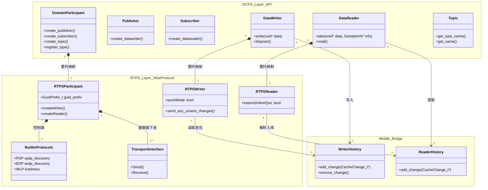
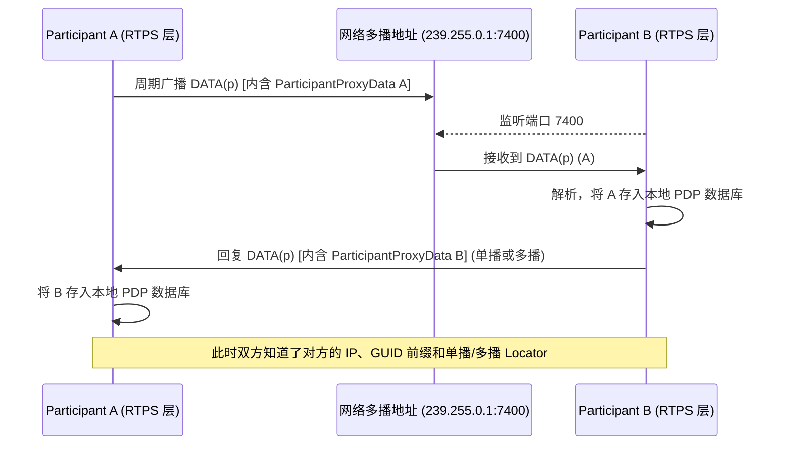
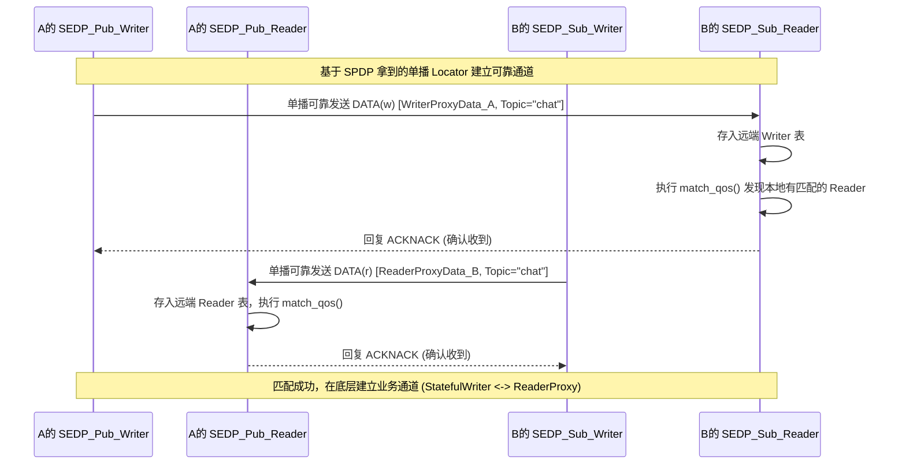
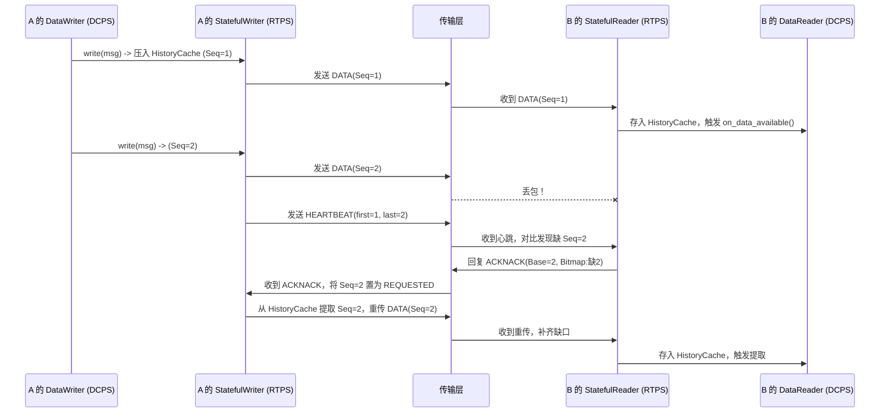

### 1. DCPS 层与 RTPS 层的架构图、功能 List 与划分边界深度解析

以下架构图与边界定义完全基于 **OMG DDS 规范 (v1.4)** 与 **OMG RTPS 规范 (v2.3)**，并映射至主流开源实现（如 eProsima Fast DDS）的代码层级。

  

代码段



**功能 List 与划分边界原因：**

  

|**层次**|**核心功能 List (基于源码抽象)**|**划分边界与原因**|
|---|---|---|
|**DCPS 层**<br><br>  <br>  <br><br>(数据中心层)|1. 业务对象生命周期管理 (Pub/Sub/Topic等)<br><br>  <br>  <br><br>2. **QoS 策略的存储与校验** (如 Deadline, Liveliness, Reliability)<br><br>  <br>  <br><br>3. **类型序列化/反序列化** (TypeSupport 挂载)<br><br>  <br>  <br><br>4. 用户层回调通知触发 (WaitSet, Listener)|**边界：** 不直接操作网络 Socket，不感知底层是组播还是单播。所有业务报文在此层被转换为统一的 `CacheChange_t` 结构并压入 HistoryCache。<br><br>  <br>  <br><br>**原因：解耦业务语义与网络传输。** 应用层只关心“发什么、要求什么质量”，使业务代码无需随底层网络（如切换共享内存、UDP、TCP）而修改。|
|**RTPS 层**<br><br>  <br>  <br><br>(有线协议层)|1. 实体全局唯一标识路由 (`GUID_t`)<br><br>  <br>  <br><br>2. **分布式缓存同步机制** (发包、心跳 `HEARTBEAT`、重传请求 `ACKNACK`)<br><br>  <br>  <br><br>3. **网络拓扑发现状态机** (SPDP / SEDP内置端点运行)<br><br>  <br>  <br><br>4. 将 `CacheChange_t` 序列化为 `RTPS Message` 字节流并送往 Transport|**边界：** 只负责把 HistoryCache 中的二进制载荷按照 QoS 契约可靠或尽力而为地搬运到远端对应 `GUID` 的端点。不解析业务数据类型。<br><br>  <br>  <br><br>**原因：实现不同厂商 DDS 的互操作性。** 只要遵守 RTPS 二进制封包与状态机规范，Fast DDS 可以和 Cyclone DDS 完美通信。|

### 2. UML 序列图：SPDP、SEDP 与数据面发布订阅流程

#### 图 1：SPDP 流程（简单参与者发现，盲建拓扑）

代码段



#### 图 2：SEDP 流程（简单端点发现，==🔴QoS 匹配与能力交换==）
代码段



#### 图 3：数据面发布-订阅过程（含丢包重传状态机）

代码段



### 3. RTPS 规范严格的端口计算公式及重要协议规定

完全来自 OMG RTPS v2.3 Specification (Section 9.6.1.1):

  

**端口计算核心公式：**`PortNumber = PB + DG * domainId + offset`

  

**系统预设常量：**

  

- **PB (Port Base)**: `7400`
    
      
    
- **DG (DomainId Gain)**: `250`
    
      
    
- **PG (ParticipantId Gain)**: `2`
    
      
    
- **d0 (Discovery Multicast Offset)**: `0`
    
      
    
- **d1 (Discovery Unicast Offset)**: `10`
    
      
    
- **d2 (User Multicast Offset)**: `1`
    
      
    
- **d3 (User Unicast Offset)**: `11`
    
      
    

**各端口具体计算（推导）：**

  

1. **SPDP 发现多播端口 (Discovery Multicast)**`Port = 7400 + (250 * DomainId) + 0`_例如：Domain 0 的多播发现端口固定为 7400。_
    
      
    
2. **SEDP 发现单播端口 (Discovery Unicast)**`Port = 7400 + (250 * DomainId) + 10 + (2 * ParticipantId)`_例如：Domain 0 中第 1 个启动的 Participant (Id=0) 单播端口为 7410，第 2 个 (Id=1) 为 7412。_
    
      
    
3. **用户业务多播端口 (User Multicast)**`Port = 7400 + (250 * DomainId) + 1`_例如：Domain 0 业务多播为 7401。_
    
      
    
4. **用户业务单播端口 (User Unicast)**`Port = 7400 + (250 * DomainId) + 11 + (2 * ParticipantId)`_例如：Domain 0 中 Participant 0 业务单播为 7411。_
    
      
    

**重要底层协议强制规定：**

  

1. **Endianness 标志独立性**：RTPS Header 不规定全局大小端，而是每个 `SubmessageHeader` 的第 0 位（Flag `E`）指示当前子报文的大/小端序。接收端必须根据该 flag 实时翻转字节序（通常 E=1 为小端，E=0 为大端）。
    
      
    
2. **GUID 结构与空间**：`GUID_t` = 12字节 `GuidPrefix_t` (区分 Participant 机器/进程) + 4字节 `EntityId_t`。其中 `EntityId_t` 最后 1 字节为 `EntityKind`，严格区分内建对象与用户对象（例如用户 Writer 尾号 `0x02`，内建 Writer `0xc2`）。
    
      
    

### 4. 本地维护的其他参与者及 Endpoint 的结构体 (C++ 源码级剖析)

以下结构体删减了业务逻辑函数，仅保留核心成员定义，真实反映了 Fast DDS 在底层 `builtin/data/` 目录下的代理信息表设计：

  

**A. 参与者代理状态 `ParticipantProxyData` (SPDP 提取)**

  

C++

```cpp
// 对应源码路径: include/fastdds/rtps/builtin/data/ParticipantProxyData.h
struct ParticipantProxyData {
    // 参与者全局唯一协议标识
    ProtocolVersion_t m_protocolVersion;
    VendorId_t m_VendorId;
    GuidPrefix_t m_guidPrefix; 

    // SPDP 和 SEDP 控制面通道地址
    ResourceLimitedVector<Locator_t> metatraffic_locators;
    // 业务数据的默认通道地址 (如果 Endpoint 没特别指定，默认用这个)
    ResourceLimitedVector<Locator_t> default_locators;
    
    // QoS: 宣告自己的存活期 (LeaseDuration)，超时未收到心跳则判定掉线
    Duration_t m_leaseDuration;

    // Bitmap掩码：宣告自己启用了哪些内置发现端点 (如 SEDP_Pub_Writer, WLP等)
    BuiltinEndpointSet_t m_availableBuiltinEndpoints;

    // 聚合映射：该远端参与者下挂载的所有 Readers 和 Writers
    ProxyHashTable<ReaderProxyData> m_readers;
    ProxyHashTable<WriterProxyData> m_writers;
};
```

**B. 写端点代理状态 `WriterProxyData` (SEDP 提取)**

  

C++

```c
// 对应源码路径: include/fastdds/rtps/builtin/data/WriterProxyData.h
struct WriterProxyData {
    // 端点的完整唯一ID
    GUID_t guid();
    
    // DCPS 语义数据元信息
    string_255 topicName();
    string_255 typeName();
    
    // 接收此 Writer 发出数据的专属单播/多播 Locator
    ResourceLimitedVector<Locator_t> remote_locators_;

    // 该 Writer 承诺的 QoS 契约表 (Offer QoS)
    WriterQos m_qos; 
    /* 内部核心 QoS：
       - m_reliability (RELIABLE or BEST_EFFORT)
       - m_durability (VOLATILE, TRANSIENT_LOCAL)
       - m_partition (逻辑分区)
       - m_ownership (独占或共享)
    */
};
```

**C. 读端点代理状态 `ReaderProxyData` (SEDP 提取)**

  

C++

```c
// 对应源码路径: include/fastdds/rtps/builtin/data/ReaderProxyData.h
struct ReaderProxyData {
    GUID_t m_guid;
    
    string_255 m_topicName;
    string_255 m_typeName;
    
    // 这个 Reader 监听业务数据的专属 Locator
    ResourceLimitedVector<Locator_t> remote_locators_;

    // 该 Reader 请求的 QoS 契约表 (Requested QoS)
    ReaderQos m_qos; 
    /* RxO (Requested vs Offered) 匹配发生于此：
       如果该 Reader 的 m_reliability = RELIABLE，但 
       Writer 的 m_reliability = BEST_EFFORT，底层匹配失败，不建连。
    */
};
```

### 5. 从原始 Message 到底层传输报文的过程及格式分解

当 DCPS 层的 `DataWriter` 写入一条数据，或者 SPDP 周期性触发广播时，数据是如何层层套壳发入网卡的？

  

**报文封装层次图 (ASCII Art):**

  

Plaintext

```
+-----------------------------------------------------------+
| UDP Header (源IP, 目的IP:7400, 校验和)                      |
+===========================================================+
| RTPS Message Header (20 Bytes)                            |
|  - "RTPS", 版本, Vendor, 发送端 GuidPrefix                 |
+-----------------------------------------------------------+
| Submessage 1 Header (4 Bytes, 比如 INFO_TS 告知时间戳)      |
| Submessage 1 Payload (8 Bytes, 时间戳结构)                 |
+-----------------------------------------------------------+
| Submessage 2 Header (4 Bytes, DATA 子报文)                 |
| Submessage 2 Payload:                                     |
|    - ExtraFlags, OctetsToInlineQos                        |
|    - ReaderId, WriterId (EntityId)                        |
|    - SequenceNumber (序列号, 8 Bytes)                      |
|    - SerializedData (真正的 CDR 序列化负载 / SPDP PID表)      |
+-----------------------------------------------------------+
```

**底层代码级别的 C++ 结构体拆解（完全映射上述格式）：**

  

1. **RTPS Message Header 封包格式**
    
      
    

C++

```c
// 所有 RTPS 数据包的物理帧头，20字节死结构
struct Header_t {
    char protocolName[4];          // 固定为 'R', 'T', 'P', 'S'
    ProtocolVersion_t version;     // {2, 3} (RTPS 2.3)
    VendorId_t vendorId;           // 例如 FastDDS 为 0x010F
    GuidPrefix_t guidPrefix;       // 12 字节发送者参与者前缀
};
```

2. **Submessage Header 子报文帧头** 由于一个 UDP 报文可以拼装多个子报文（如一个 DATA 和一个 HEARTBEAT 打包发），每个子报文都有独立的 4 字节头。
    
      
    

C++

```c
struct SubmessageHeader_t {
    octet submessageId;    // 子报文类型：DATA=0x15, HEARTBEAT=0x07, ACKNACK=0x06
    octet flags;           // 标志位（第0位永远代表字节序 E flag, X/Q 标志位等）
    uint16_t submessageLength; // 当前子报文负载长度（方便跳过不认识的子报文）
};
```

3. **SPDP 报文载荷特性 (PID LIST)** 如果在 SPDP 发现阶段，其发送的是一个 `DATA` 子报文，它的 `SerializedData` 并不是用户的业务结构体，而是一个 **参数列表 (Parameter List / PID LIST)**，格式为 `[PID, Length, Value]`：
    
      
    

Plaintext

```c
// SPDP 的载荷在网线上的直接表现（16进制截断示例）：
[PID: PID_PROTOCOL_VERSION (0x0015)] [Len: 4] [Value: 0x02 0x03 0x00 0x00]
[PID: PID_VENDORID (0x0016)] [Len: 4] [Value: 0x01 0x0F 0x00 0x00]
[PID: PID_PARTICIPANT_GUID (0x0050)] [Len: 16] [Value: 12字节Prefix + 4字节EntityId]
[PID: PID_SENTINEL (0x0001)] [Len: 0] (列表结束标识)
```

**处理阶段概述：**

  

1. **序列化阶段：** 业务层的数据或 `ParticipantProxyData` 被 CDR (Common Data Representation) 序列化或转为 PID 列表，填入 `CacheChange_t`。
    
      
    
2. **装配阶段：** RTPS 层的 MessageBuilder 提取 `CacheChange_t`，拼接 `Header_t`、`SubmessageHeader_t` 和相关额外标识（如 `INFO_TS`）。
    
      
    
3. **下发阶段：** 组合好的整个大 Buffer 被丢给 `TransportInterface::Send(buffer, locator)`，封装进操作系统的 UDP payload 送入物理网卡。